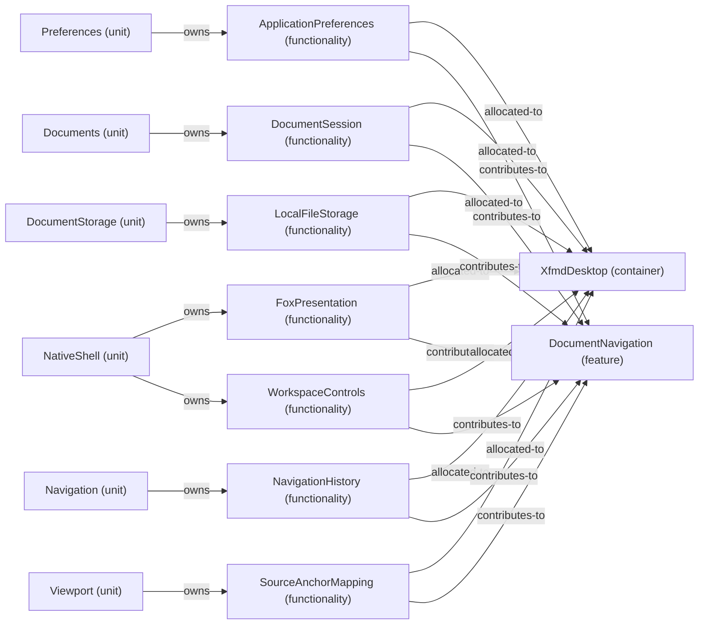

# Feature: DocumentNavigation — mode NormalDesktop

[Viewpoint](index.md) · [Navigator](../../navigator.md)

Revision: `e2a2f39e5c78476bb1bba08e406114367eb59953f02a63e952e435c880d24007`.

## Feature: DocumentNavigation — mode NormalDesktop

Source facts: f0046, f0049, f0207, f0208, f0222, f0232, f0351, f0353, f0523, f0524, f0544, f0545, f0576, f0587, f0589, f0652, f0907, f0910, f0966, f1013, f1016.

