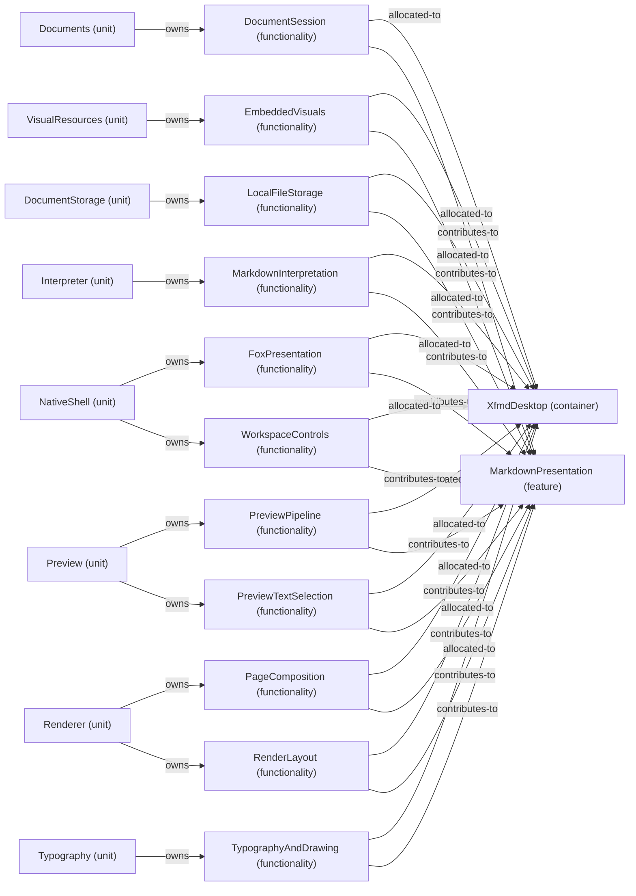

# Feature: MarkdownPresentation — mode NormalDesktop

[Viewpoint](index.md) · [Navigator](../../navigator.md)

Revision: `e2a2f39e5c78476bb1bba08e406114367eb59953f02a63e952e435c880d24007`.

## Feature: MarkdownPresentation — mode NormalDesktop

Source facts: f0207, f0210, f0222, f0232, f0274, f0275, f0351, f0355, f0484, f0523, f0525, f0531, f0533, f0544, f0545, f0600, f0601, f0687, f0688, f0717, f0719, f0740, f0741, f0837, f0839, f0845, f0846, f0944, f0946, f0947, f0984, f1013, f1018.

