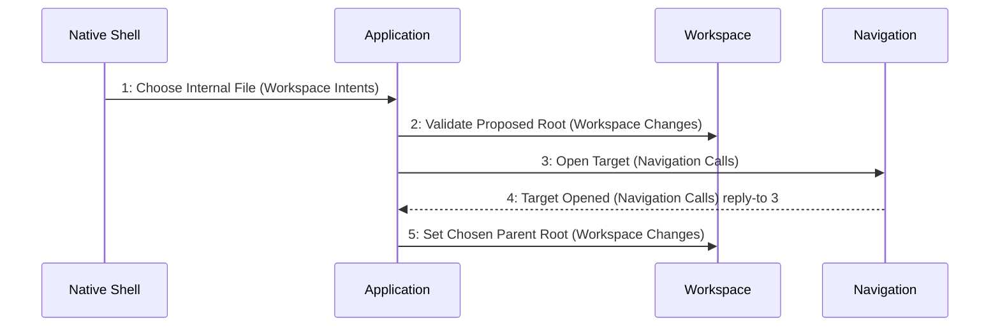

# Scenario: ChooserOpensThenChangesRoot — mode NormalDesktop

[Viewpoint](index.md) · [Navigator](../../navigator.md)

Revision: `e2a2f39e5c78476bb1bba08e406114367eb59953f02a63e952e435c880d24007`.

## Scenario: ChooserOpensThenChangesRoot — mode NormalDesktop

Source facts: f0036, f0037, f0040, f0041, f0043, f0083, f0084, f0090, f0091, f0092, f0093, f0094, f0095, f0096, f0097, f0573, f0581, f0582, f0583, f0585, f0586, f0595, f0596, f0901, f0902, f0929, f0930, f0931, f0959, f0960, f1002, f1003, f1007, f1011, f1012, f1023, f1026.

