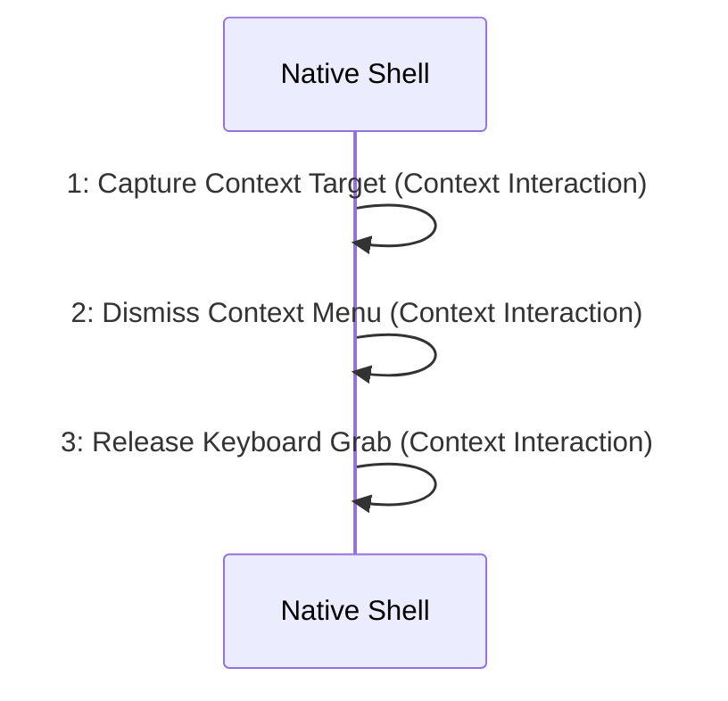

# Scenario: ContextMenuDismissed — mode NormalDesktop

[Viewpoint](index.md) · [Navigator](../../navigator.md)

Revision: `e2a2f39e5c78476bb1bba08e406114367eb59953f02a63e952e435c880d24007`.

## Scenario: ContextMenuDismissed — mode NormalDesktop

Source facts: f0073, f0074, f0108, f0110, f0111, f0112, f0113, f0114, f0115, f0116, f0117, f0118, f0163, f0164, f0546, f0547, f0548, f0549, f0550, f0551, f0825, f0826.

