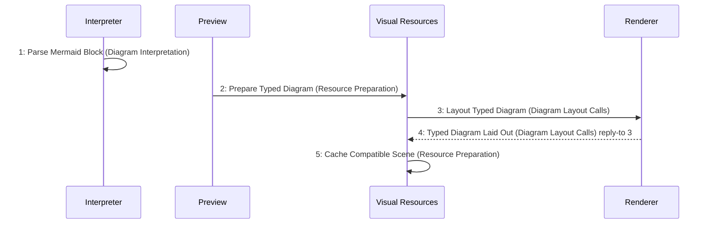

# Scenario: DiagramScenePrepared — mode NormalDesktop

[Viewpoint](index.md) · [Navigator](../../navigator.md)

Revision: `e2a2f39e5c78476bb1bba08e406114367eb59953f02a63e952e435c880d24007`.

## Scenario: DiagramScenePrepared — mode NormalDesktop

Source facts: f0059, f0060, f0126, f0128, f0131, f0133, f0134, f0137, f0138, f0139, f0140, f0141, f0142, f0143, f0144, f0486, f0487, f0511, f0512, f0610, f0611, f0675, f0676, f0707, f0847, f0848, f0859, f0861, f0865, f0941, f0942, f0943, f0985, f0986, f0987, f0991, f0992.

