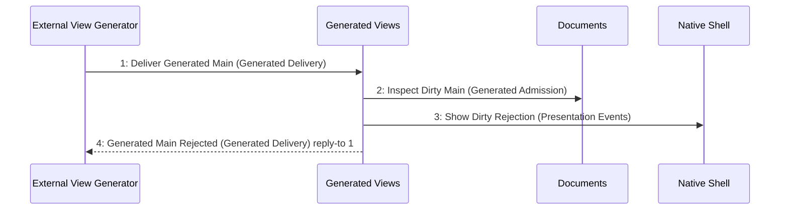

# Scenario: DirtyGeneratedDeliveryRejected — mode NormalDesktop

[Viewpoint](index.md) · [Navigator](../../navigator.md)

Revision: `e2a2f39e5c78476bb1bba08e406114367eb59953f02a63e952e435c880d24007`.

## Scenario: DirtyGeneratedDeliveryRejected — mode NormalDesktop

Source facts: f0124, f0125, f0145, f0146, f0147, f0148, f0149, f0150, f0151, f0245, f0323, f0324, f0367, f0370, f0373, f0375, f0377, f0396, f0397, f0398, f0430, f0433, f0435, f0451, f0473, f0474, f0560, f0679, f0682, f0905, f0906.

