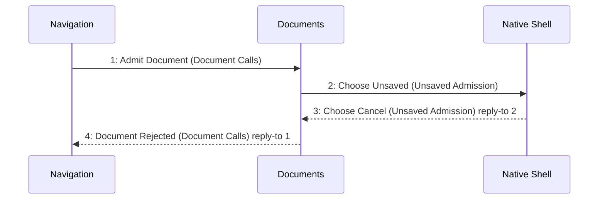

# Scenario: DirtyOpenCancelled — mode NormalDesktop

[Viewpoint](index.md) · [Navigator](../../navigator.md)

Revision: `e2a2f39e5c78476bb1bba08e406114367eb59953f02a63e952e435c880d24007`.

## Scenario: DirtyOpenCancelled — mode NormalDesktop

Source facts: f0010, f0011, f0080, f0081, f0082, f0088, f0089, f0152, f0153, f0154, f0155, f0156, f0157, f0158, f0167, f0169, f0171, f0202, f0203, f0204, f0234, f0236, f0254, f0256, f0563, f0564, f0578, f0579, f0950, f0952, f0954.

