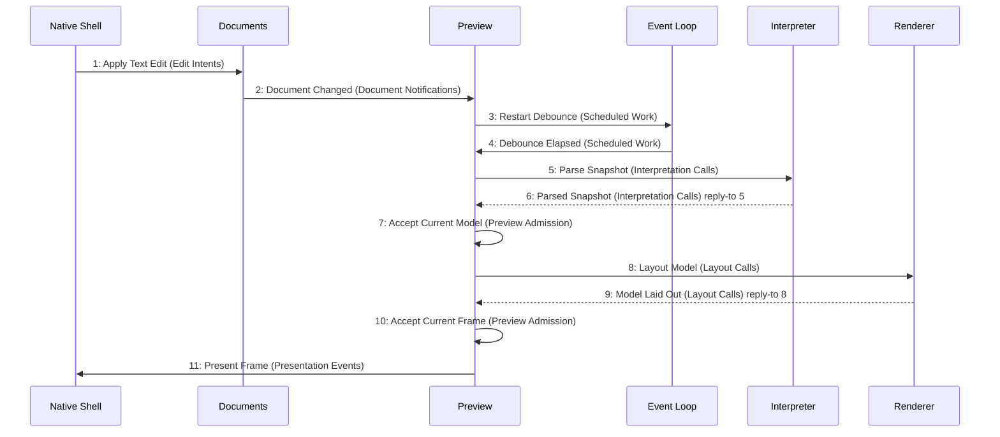

# Scenario: EditedPreviewPublished — mode NormalDesktop

[Viewpoint](index.md) · [Navigator](../../navigator.md)

Revision: `e2a2f39e5c78476bb1bba08e406114367eb59953f02a63e952e435c880d24007`.

## Scenario: EditedPreviewPublished — mode NormalDesktop

Source facts: f0000, f0001, f0002, f0003, f0052, f0053, f0122, f0123, f0172, f0173, f0191, f0194, f0238, f0244, f0257, f0259, f0260, f0261, f0262, f0263, f0264, f0265, f0266, f0267, f0268, f0269, f0270, f0271, f0272, f0273, f0277, f0278, f0479, f0481, f0482, f0490, f0491, f0503, f0505, f0506, f0509, f0510, f0541, f0542, f0543, f0552, f0559, f0614, f0615, f0616, f0617, f0618, f0677, f0678, f0679, f0681, f0689, f0690, f0691, f0692, f0693, f0694, f0695, f0696, f0700, f0701, f0708, f0709, f0710, f0712, f0713, f0851, f0852, f0866, f0867, f0884, f0886, f0888.

