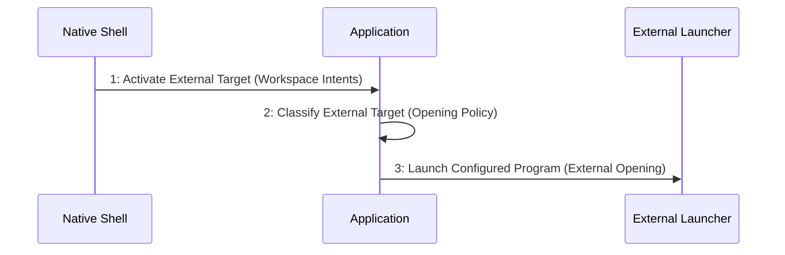

# Scenario: ExternalTargetHandedOff — mode NormalDesktop

[Viewpoint](index.md) · [Navigator](../../navigator.md)

Revision: `e2a2f39e5c78476bb1bba08e406114367eb59953f02a63e952e435c880d24007`.

## Scenario: ExternalTargetHandedOff — mode NormalDesktop

Source facts: f0006, f0007, f0035, f0038, f0039, f0042, f0098, f0099, f0311, f0312, f0314, f0315, f0316, f0317, f0318, f0319, f0320, f0501, f0502, f0572, f0597, f0599, f1023, f1025.

