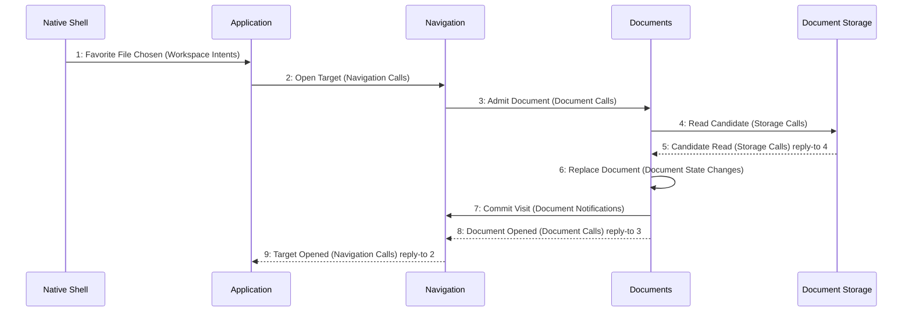

# Scenario: FavoriteFileOpens — mode NormalDesktop

[Viewpoint](index.md) · [Navigator](../../navigator.md)

Revision: `e2a2f39e5c78476bb1bba08e406114367eb59953f02a63e952e435c880d24007`.

## Scenario: FavoriteFileOpens — mode NormalDesktop

Source facts: f0010, f0011, f0036, f0037, f0044, f0067, f0068, f0069, f0102, f0103, f0167, f0169, f0170, f0191, f0193, f0196, f0197, f0198, f0212, f0215, f0225, f0227, f0234, f0235, f0237, f0241, f0243, f0249, f0252, f0327, f0328, f0329, f0330, f0331, f0332, f0333, f0334, f0335, f0336, f0337, f0338, f0339, f0340, f0574, f0577, f0579, f0580, f0581, f0582, f0583, f0585, f0586, f0595, f0596, f0782, f0783, f0853, f0854, f0921, f0923, f0926, f0929, f0930, f0931, f1023, f1027.

