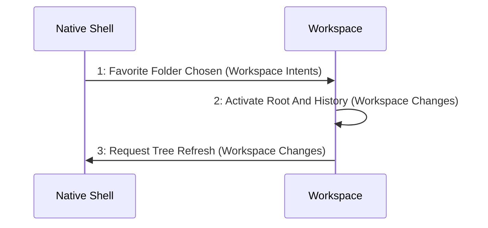

# Scenario: FavoriteFolderChangesRoot — mode NormalDesktop

[Viewpoint](index.md) · [Navigator](../../navigator.md)

Revision: `e2a2f39e5c78476bb1bba08e406114367eb59953f02a63e952e435c880d24007`.

## Scenario: FavoriteFolderChangesRoot — mode NormalDesktop

Source facts: f0008, f0009, f0341, f0342, f0343, f0344, f0345, f0346, f0347, f0348, f0571, f0575, f0857, f0858, f1001, f1004, f1005, f1006, f1007, f1009, f1010, f1023, f1028.

