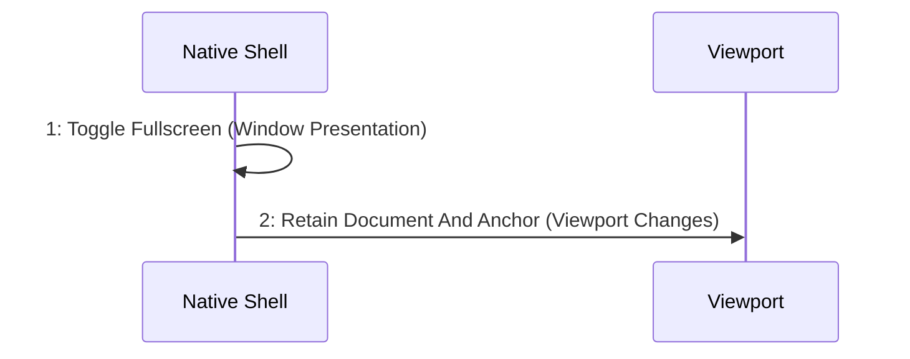

# Scenario: FullscreenChangesPresentation — mode NormalDesktop

[Viewpoint](index.md) · [Navigator](../../navigator.md)

Revision: `e2a2f39e5c78476bb1bba08e406114367eb59953f02a63e952e435c880d24007`.

## Scenario: FullscreenChangesPresentation — mode NormalDesktop

Source facts: f0362, f0363, f0364, f0365, f0366, f0567, f0569, f0570, f0868, f0869, f0939, f0940, f0969, f0974, f0978, f0993, f0995.

