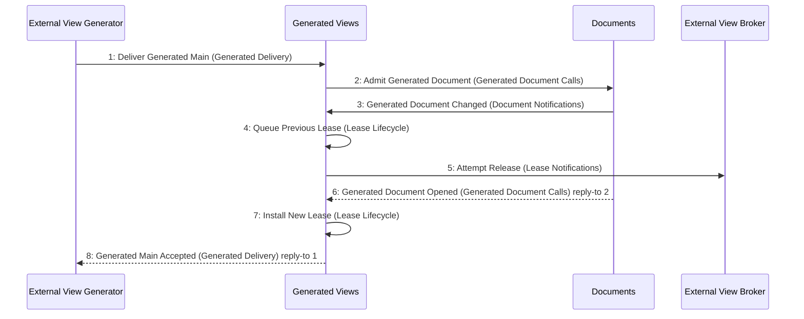

# Scenario: GeneratedReplacementReleasesOldLease — mode NormalDesktop

[Viewpoint](index.md) · [Navigator](../../navigator.md)

Revision: `e2a2f39e5c78476bb1bba08e406114367eb59953f02a63e952e435c880d24007`.

## Scenario: GeneratedReplacementReleasesOldLease — mode NormalDesktop

Source facts: f0012, f0013, f0054, f0055, f0124, f0125, f0191, f0195, f0239, f0246, f0247, f0321, f0322, f0324, f0373, f0375, f0376, f0378, f0380, f0381, f0382, f0383, f0386, f0387, f0388, f0393, f0394, f0395, f0399, f0400, f0401, f0402, f0403, f0404, f0405, f0406, f0407, f0408, f0409, f0425, f0433, f0434, f0436, f0437, f0442, f0444, f0446, f0448, f0450, f0475, f0476, f0513, f0515, f0517, f0519, f0521, f0780, f0781.

