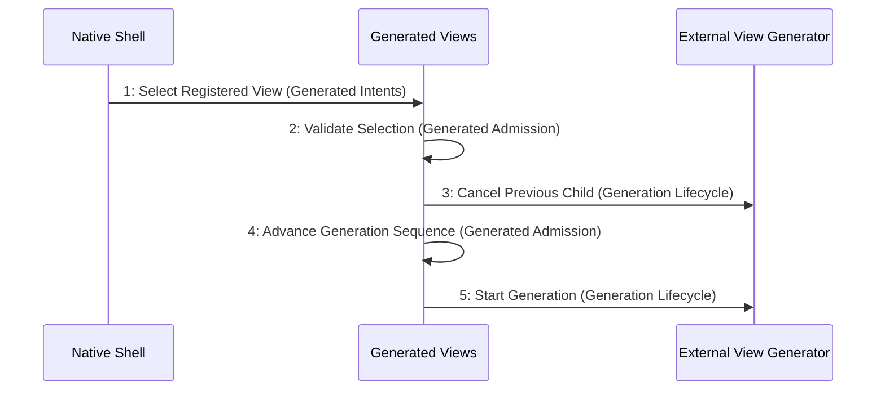

# Scenario: GeneratedSelectionSupersedes — mode NormalDesktop

[Viewpoint](index.md) · [Navigator](../../navigator.md)

Revision: `e2a2f39e5c78476bb1bba08e406114367eb59953f02a63e952e435c880d24007`.

## Scenario: GeneratedSelectionSupersedes — mode NormalDesktop

Source facts: f0016, f0017, f0063, f0064, f0325, f0326, f0367, f0369, f0372, f0389, f0392, f0411, f0412, f0413, f0414, f0415, f0416, f0417, f0418, f0426, f0428, f0429, f0432, f0439, f0440, f0441, f0453, f0455, f0456, f0554, f0899, f0900, f0919, f0920, f0961, f0962.

