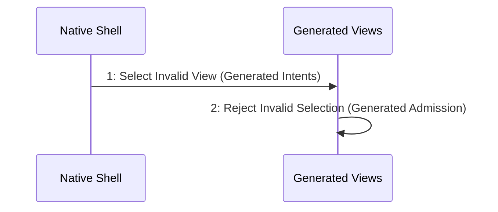

# Scenario: InvalidSelectionRetainsChild — mode NormalDesktop

[Viewpoint](index.md) · [Navigator](../../navigator.md)

Revision: `e2a2f39e5c78476bb1bba08e406114367eb59953f02a63e952e435c880d24007`.

## Scenario: InvalidSelectionRetainsChild — mode NormalDesktop

Source facts: f0367, f0371, f0389, f0391, f0427, f0431, f0438, f0494, f0495, f0496, f0497, f0498, f0553, f0823, f0824, f0897, f0898.

