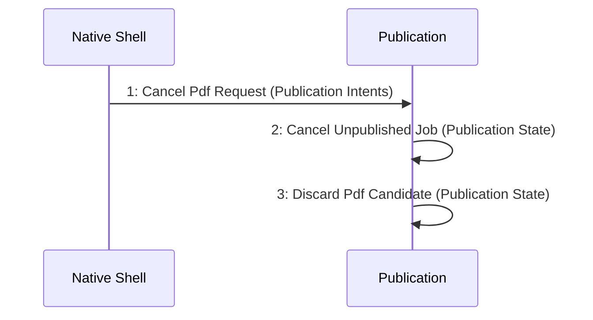

# Scenario: PdfCancelledBeforePublication — mode NormalDesktop

[Viewpoint](index.md) · [Navigator](../../navigator.md)

Revision: `e2a2f39e5c78476bb1bba08e406114367eb59953f02a63e952e435c880d24007`.

## Scenario: PdfCancelledBeforePublication — mode NormalDesktop

Source facts: f0061, f0062, f0065, f0066, f0161, f0162, f0561, f0619, f0620, f0621, f0622, f0623, f0624, f0754, f0756, f0758, f0759, f0761, f0769, f0771, f0773, f0775, f0777.

