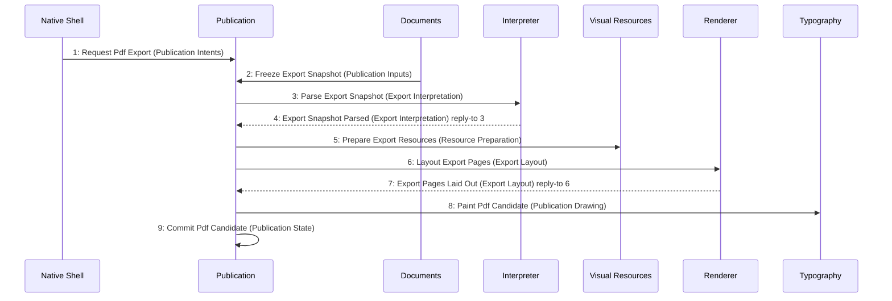

# Scenario: PdfSnapshotPublished — mode NormalDesktop

[Viewpoint](index.md) · [Navigator](../../navigator.md)

Revision: `e2a2f39e5c78476bb1bba08e406114367eb59953f02a63e952e435c880d24007`.

## Scenario: PdfSnapshotPublished — mode NormalDesktop

Source facts: f0100, f0101, f0248, f0288, f0290, f0291, f0292, f0294, f0295, f0296, f0297, f0298, f0303, f0304, f0305, f0359, f0360, f0488, f0489, f0507, f0508, f0562, f0606, f0607, f0608, f0609, f0628, f0629, f0630, f0631, f0632, f0633, f0634, f0635, f0636, f0637, f0638, f0639, f0673, f0674, f0748, f0749, f0750, f0751, f0752, f0753, f0755, f0757, f0760, f0762, f0763, f0765, f0766, f0768, f0769, f0772, f0773, f0776, f0849, f0850, f0855, f0856, f0859, f0864, f0945, f0990.

