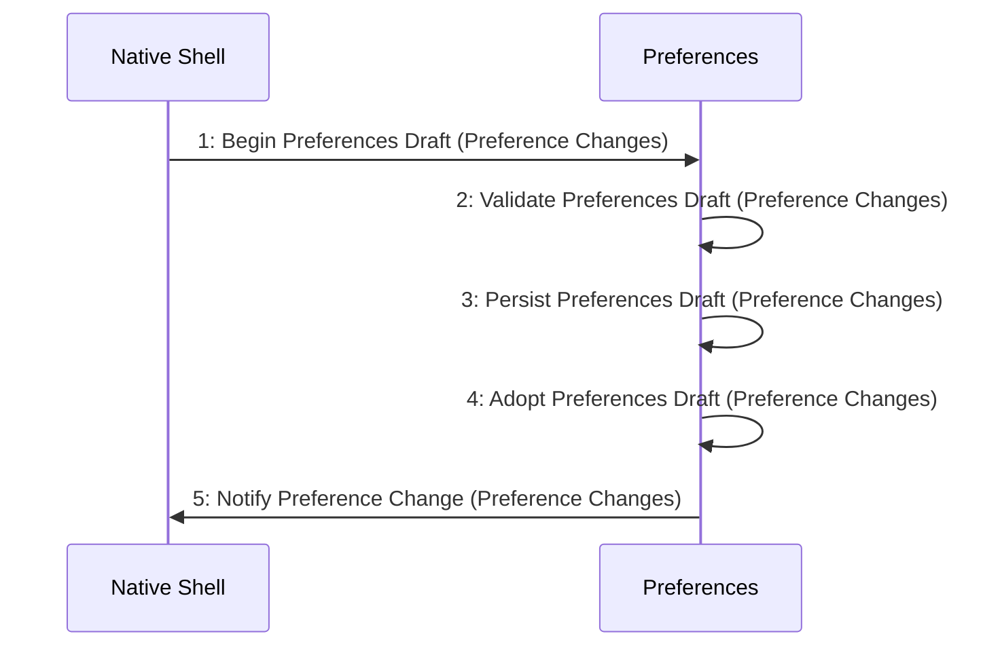

# Scenario: PreferencesPersistBeforeAdoption — mode NormalDesktop

[Viewpoint](index.md) · [Navigator](../../navigator.md)

Revision: `e2a2f39e5c78476bb1bba08e406114367eb59953f02a63e952e435c880d24007`.

## Scenario: PreferencesPersistBeforeAdoption — mode NormalDesktop

Source facts: f0014, f0015, f0056, f0057, f0557, f0558, f0591, f0592, f0640, f0641, f0644, f0646, f0647, f0648, f0649, f0650, f0653, f0654, f0655, f0656, f0657, f0658, f0659, f0660, f0661, f0662, f0663, f0664, f0665, f0666, f0667, f0668, f0957, f0958.

