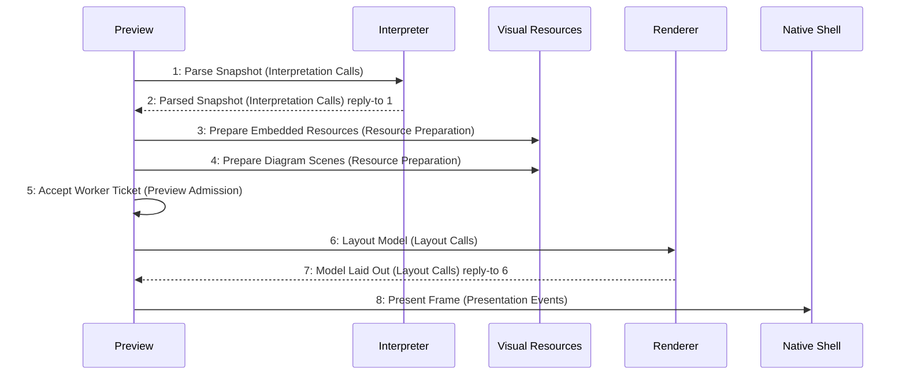

# Scenario: PreviewResourcesPrepared — mode NormalDesktop

[Viewpoint](index.md) · [Navigator](../../navigator.md)

Revision: `e2a2f39e5c78476bb1bba08e406114367eb59953f02a63e952e435c880d24007`.

## Scenario: PreviewResourcesPrepared — mode NormalDesktop

Source facts: f0004, f0005, f0479, f0481, f0482, f0490, f0491, f0503, f0505, f0506, f0509, f0510, f0541, f0542, f0543, f0559, f0614, f0615, f0616, f0617, f0618, f0669, f0670, f0671, f0672, f0677, f0678, f0679, f0681, f0690, f0691, f0692, f0693, f0694, f0697, f0702, f0705, f0706, f0710, f0714, f0722, f0723, f0724, f0725, f0726, f0727, f0728, f0729, f0730, f0731, f0732, f0851, f0852, f0859, f0862, f0863, f0988, f0989.

