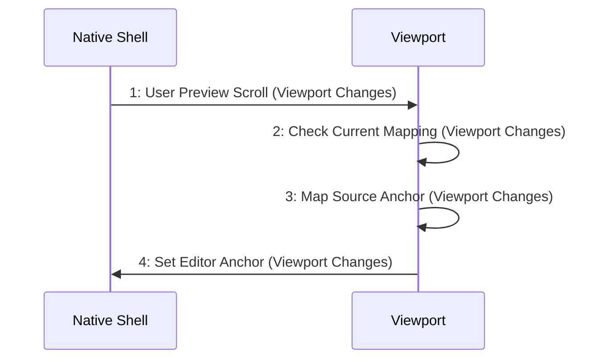

# Scenario: PreviewScrollSynchronizesEditor — mode NormalDesktop

[Viewpoint](index.md) · [Navigator](../../navigator.md)

Revision: `e2a2f39e5c78476bb1bba08e406114367eb59953f02a63e952e435c880d24007`.

## Scenario: PreviewScrollSynchronizesEditor — mode NormalDesktop

Source facts: f0076, f0077, f0527, f0528, f0566, f0568, f0733, f0734, f0735, f0736, f0737, f0738, f0739, f0903, f0904, f0955, f0956, f0967, f0968, f0970, f0971, f0972, f0973, f0974, f0976, f0977, f0979, f0980.

