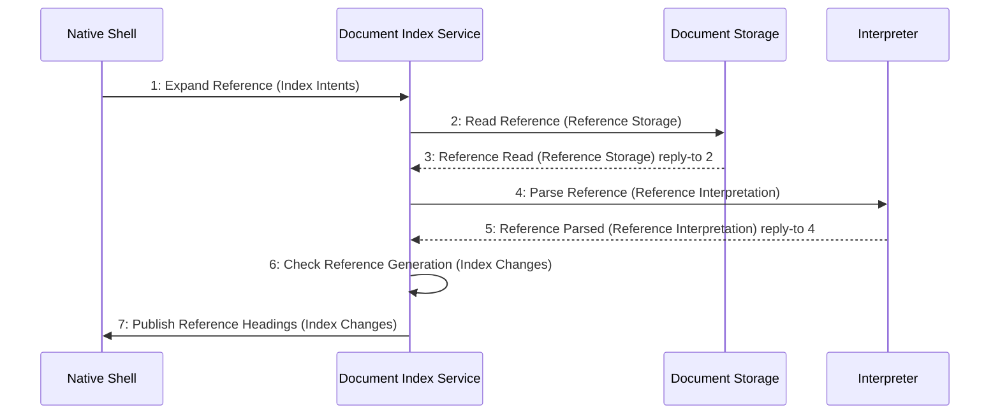

# Scenario: ReferenceHeadingsLoaded — mode NormalDesktop

[Viewpoint](index.md) · [Navigator](../../navigator.md)

Revision: `e2a2f39e5c78476bb1bba08e406114367eb59953f02a63e952e435c880d24007`.

## Scenario: ReferenceHeadingsLoaded — mode NormalDesktop

Source facts: f0078, f0079, f0182, f0183, f0184, f0185, f0186, f0187, f0188, f0189, f0223, f0224, f0282, f0283, f0466, f0468, f0469, f0470, f0472, f0492, f0493, f0555, f0556, f0612, f0613, f0778, f0779, f0784, f0785, f0797, f0798, f0799, f0800, f0801, f0802, f0803, f0804, f0805, f0806, f0807, f0809, f0810, f0811, f0812, f0813, f0814, f0815, f0816, f0817, f0819, f0820.

