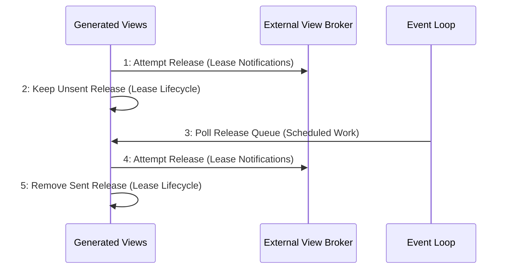

# Scenario: ReleaseRetryAfterSendFailure — mode NormalDesktop

[Viewpoint](index.md) · [Navigator](../../navigator.md)

Revision: `e2a2f39e5c78476bb1bba08e406114367eb59953f02a63e952e435c880d24007`.

## Scenario: ReleaseRetryAfterSendFailure — mode NormalDesktop

Source facts: f0054, f0055, f0279, f0321, f0443, f0445, f0447, f0449, f0450, f0452, f0499, f0500, f0513, f0516, f0518, f0519, f0521, f0642, f0643, f0827, f0828, f0829, f0830, f0831, f0832, f0833, f0834, f0835, f0836, f0884, f0887.

