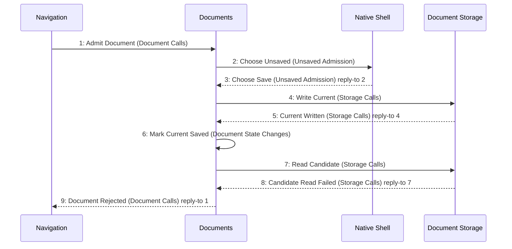

# Scenario: SaveThenReadFails — mode NormalDesktop

[Viewpoint](index.md) · [Navigator](../../navigator.md)

Revision: `e2a2f39e5c78476bb1bba08e406114367eb59953f02a63e952e435c880d24007`.

## Scenario: SaveThenReadFails — mode NormalDesktop

Source facts: f0010, f0011, f0070, f0071, f0072, f0085, f0086, f0087, f0088, f0089, f0119, f0120, f0121, f0167, f0169, f0171, f0202, f0203, f0204, f0212, f0214, f0225, f0226, f0228, f0229, f0234, f0236, f0240, f0242, f0250, f0251, f0252, f0253, f0255, f0256, f0529, f0530, f0563, f0565, f0578, f0579, f0782, f0783, f0870, f0871, f0872, f0873, f0874, f0875, f0876, f0877, f0878, f0879, f0880, f0881, f0921, f0924, f0925, f0926, f0927, f0950, f0953, f0954, f1029, f1030.

