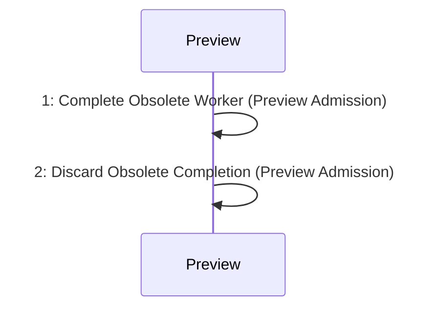

# Scenario: StalePreviewDiscarded — mode NormalDesktop

[Viewpoint](index.md) · [Navigator](../../navigator.md)

Revision: `e2a2f39e5c78476bb1bba08e406114367eb59953f02a63e952e435c880d24007`.

## Scenario: StalePreviewDiscarded — mode NormalDesktop

Source facts: f0104, f0105, f0159, f0160, f0698, f0699, f0703, f0704, f0710, f0715, f0716, f0914, f0915, f0916, f0917, f0918.

