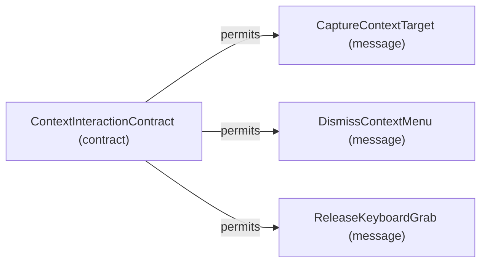

# Contract structure: ContextInteractionContract

[Viewpoint](index.md) · [Navigator](../../navigator.md)

Revision: `e2a2f39e5c78476bb1bba08e406114367eb59953f02a63e952e435c880d24007`.

## Contract structure: ContextInteractionContract

Source facts: f0110, f0111, f0112.

