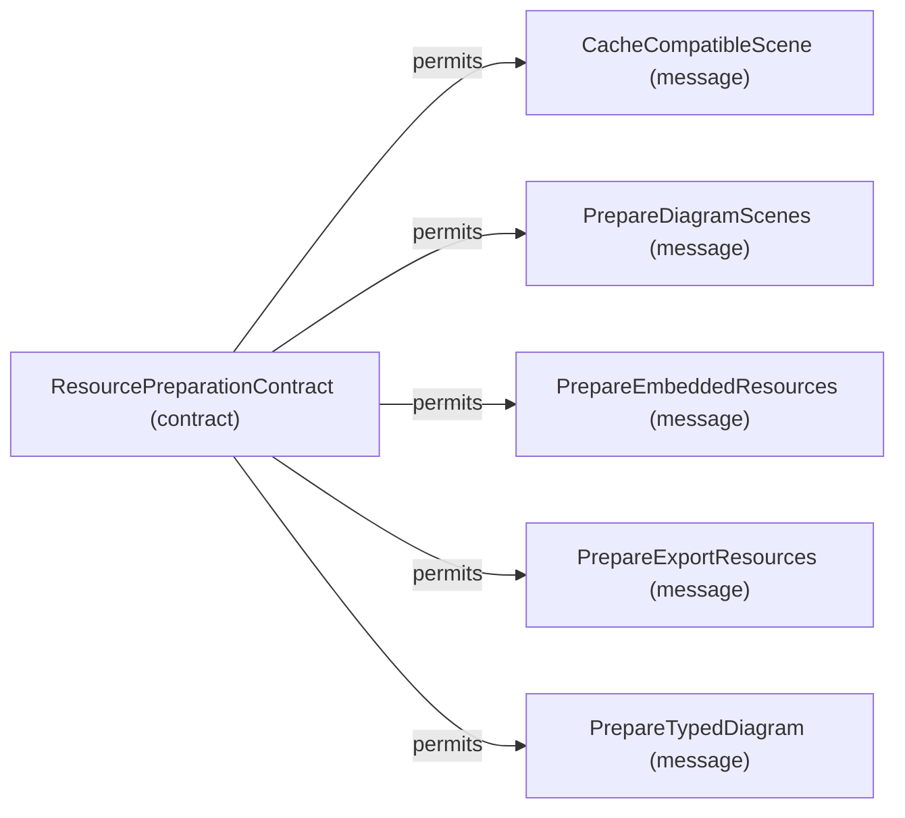

# Contract structure: ResourcePreparationContract

[Viewpoint](index.md) · [Navigator](../../navigator.md)

Revision: `e2a2f39e5c78476bb1bba08e406114367eb59953f02a63e952e435c880d24007`.

## Contract structure: ResourcePreparationContract

Source facts: f0861, f0862, f0863, f0864, f0865.

