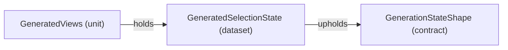

# Data origin and holder: GeneratedSelectionState

[Viewpoint](index.md) · [Navigator](../../navigator.md)

Revision: `e2a2f39e5c78476bb1bba08e406114367eb59953f02a63e952e435c880d24007`.

## Data origin and holder: GeneratedSelectionState

Source facts: f0410, f0423.

