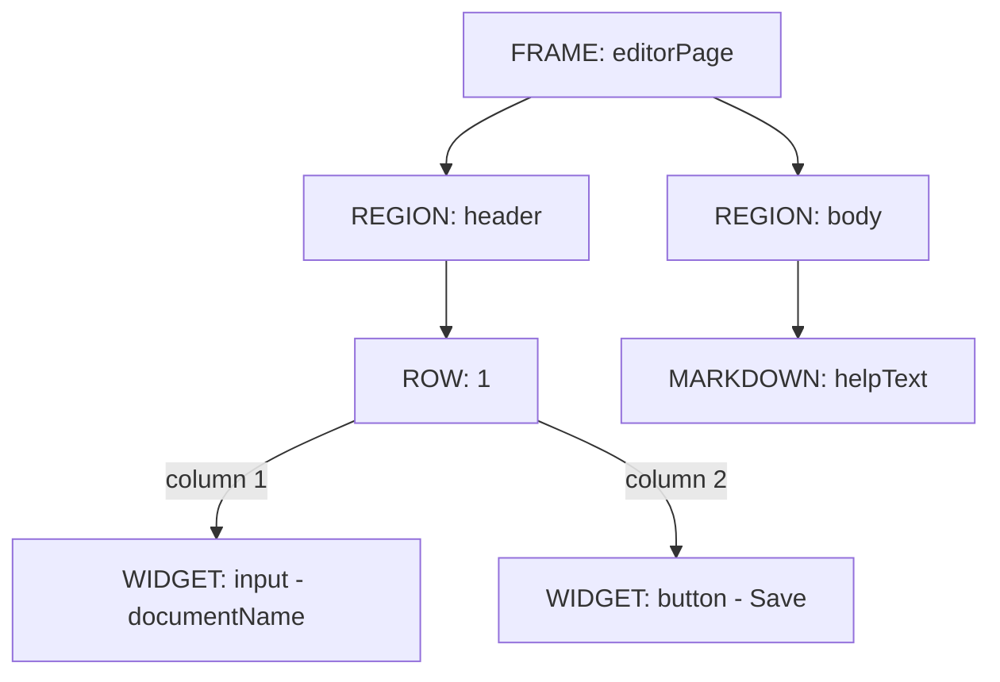
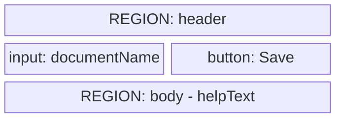
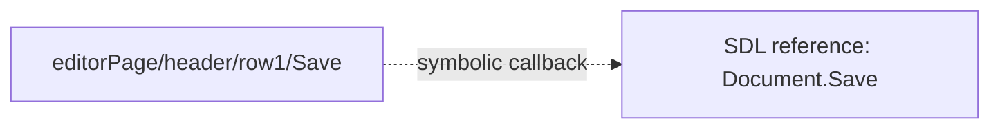

# SDUI navigation and source visualization — 2026-10-06

Investigation for KB-XFMD-025/026, Session 0002 T006. Inspected upstream checkout
HEAD 043c59c; this is source inspection, not a new release/runtime certification.
No authored SDL/SDUI or upstream files were modified.

## Evidence map

- XFMD src/application/sdp/SdpNavigation.cpp: on-demand select, /tmp allocation,
  retained bundles, count/byte checks, release at destruction.
- XFMD src/application/navigation/WindowEndpoint.cpp and DocumentViews.cpp:
  XDG_RUNTIME_DIR-based IPC/older navigator storage, separate from the SDP sidebar.
- SDP-vNow SDPTool/preview.go and Contract.md: 24-diagram and bundle limits.
- SDP-vNow SDPTool/sdui.go UINodes/UIPreview: existing SDUI tab, source/frame nodes,
  validated states and structural Markdown generation.
- SDP-vNow SDUI/go/parser/ast.go, normalize.go: source AST with spans, definitions,
  references/connections, ordered rows and normalized instances.
- SDP-vNow SDUI/go/presentation/markdown.go: existing static layout/content export,
  visibility filtering, no source-structure Mermaid projection.
- SDP-vNow SDUI/go/cmd/sdui-fyne/main.go: owns Fyne App/Window/ShowAndRun; symbolic
  SDL callbacks remain unbound. go.mod pins Fyne 2.8.1.
- XFMD mermaid_coverage.md and authoring fixtures: supported diagram subsets,
  existing node/depth/count limits and limitations. These are profile evidence,
  not a runtime test of the illustrative diagrams below.

## Embedding assessment

Fyne's [NativeWindow](https://docs.fyne.io/api/v2/driver/nativewindow/) exposes
RunNative; [X11WindowContext](https://docs.fyne.io/api/v2/driver/x11windowcontext/)
provides the native X11 window handle. Xlib documents
[XReparentWindow](https://www.x.org/releases/X11R7.6/doc/libX11/specs/libX11/libX11.html)
for moving a window under another parent on the same screen.

Inference: an X11-specific separate-process embedding prototype is technically
plausible. These APIs do not constitute a tested Fyne-inside-FOX integration.
The inspected host has no such adapter. Focus, native modal windows, resizing,
DPI, lifetime and event-loop coordination require a real trial. No portable
embedding contract was identified in the inspected APIs. Keep a separate Fyne
window as the initial recommendation; do not claim embedding is impossible.
Structural code visualization remains useful even if live embedding later works.

## Recognizable diagram vocabulary

| View | Recommended Mermaid form | Meaning and profile fit |
| --- | --- | --- |
| Definitions and instance composition | flowchart TD | Primary source tree; explicit frame/region/row/widget labels; ordered sibling labels; containment edges |
| One frame's row/region composition | block-beta | Optional schematic spatial arrangement with labels and spans; current XFMD supports flat blocks, not nested blocks |
| Reuse and symbolic bindings | flowchart LR | Named definitions/modules/widgets and labelled references; dotted edges separate binding/reference from containment |
| Actual specified event sequences | sequenceDiagram | Only where source/runtime contracts actually define ordering; never invent callback behavior from a widget name |

Use the same vocabulary at every depth: FRAME, REGION, ROW, WIDGET, MARKDOWN,
REFERENCE. Rectangles and labelled edges work without unsupported styling.
Include ordinary Markdown details and navigation links below each diagram; XFMD's
Mermaid subset does not provide interactive node callbacks. Avoid using class
inheritance to mean visual containment. Mindmap is less suitable as the primary
view because reuse/cross-links and edge types are important, and the current
profile has an eight-level depth limit. Deep sources need linked detail views,
not disappearing nodes. C4 is useful for host/runtime boundaries, not the widget
composition tree itself.

The following are illustrative proposed visual syntax, manually authored for
this discussion. They are not generated model viewpoints, a new SDUI grammar,
or evidence that a compiler exists. No render test of these exact sketches was
performed in this investigation.

### Primary containment view

### One frame's schematic composition

This is a source layout schematic, not an actual UI preview or pixel geometry.
For nested frames use a named frame node and a Markdown link to its detail page.

### Separate binding/reference view

An unbound reference must be labelled unbound in the accompanying details. An
arrow does not prove the action executes. Source projection should preserve
hidden/disabled/conditional source facts without treating them as runtime state.

## Producer design recommendation

Extend the existing SDUI Go presentation layer with a distinct structural mode
or operation. Reuse parse/normalize, retaining the source AST as well as normalized
instances; the latter alone may lose declarations or source-form distinctions.
Expose it through SDPTool and discovery actions, with explicit profile/revision/
entry and separate host readiness. Exact CLI/capability spelling is unselected.
Do not change existing static Markdown export semantics without a compatibility
choice. The source view must never evaluate code embedded in Markdown literals.

No duplicate SDUI tab, parallel parser, arbitrary total-content cap, new language
keyword, or executable System claim should be inferred from this proposal.
