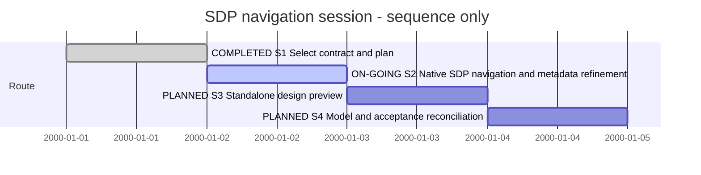

# Session — Browse and navigate SDP projects in XFMD

## Session roadmap

Latest recorded turn: T008 (local SVN design-baseline feasibility discussion). Current step: S2. Native GUI acceptance and automatic
refresh are implemented and tested; the development candidate is installed. Next
checkpoint: #021/M3a is implemented; test real Sessions after the owner-provided
producer update, finish remaining M3 boundary evidence, then S3. Dates below are **sequence only**,
not elapsed time or delivery estimates.

| State | Step | Work and linked plan milestone | Prerequisites | Authorization | Completion evidence / outcome |
| --- | --- | --- | --- | --- | --- |
| completed | S1 | Select producer contract and P1 route | Current cards and installed SDP | Owner T001 | SDP 2.0.0 / sdptool/0.2 inspected; source-derived discovery replaces old marker proposal |
| on-going | S2 | P1 M1–M3 plus M3a/#021: native navigation, dynamic tabs, labels and View source | S1 | Owner T001 authorizes as much implementation as possible | M1–M2 complete. Native GUI, automatic refresh, dirty-buffer retention, graph bounds and Back/Forward pass; development candidate installed. M3a/#021 is implemented with SN-003 evidence; updated real Sessions check pending. Remaining M3 boundary evidence is named in [SN-002](../05--Implementation/SDP-Navigation/evidence/SN-002/README.md) |
| planned | S3 | P1 M4: saved .design source/preview workflow | Shared producer adapter from S2 | Included owner goal; #015 remains backlog after #021/M3a | Pending |
| planned | S4 | P1 M5: model delta, acceptance and independent review | S2–S3 | Owner goal; review needs independent context | Structural delta already reconciled: 38 blueprints, six SDUI concepts. Further model changes held by T005/#022; semantic evidence and independent review pending; #017 remains open |

Manual Session format 1.

| Field | Value |
| --- | --- |
| Session reference | SESSION-XFMD-0001 |
| Status | active |
| Primary card | [KB-XFMD-014](../KanBan/active/%23014--Proposal--SDP-sidebar-and-generated-navigation.md) |
| Snapshot date | 2026-10-01 |
| Current step | S2 |
| Proposed next step | S2: updated real Sessions-producer check for #021/M3a, then remaining M3 acceptance; then S3 |
| Execution authority | Owner T001 implementation request; T002 installation/continuation; T003 records requested sidebar refinement in the card and plan |

## Goal

XFMD recognizes the selected project/SDP directory, offers KanBan, SDL and SDUI
navigation through producer-declared tab roots, readable model labels and source
context actions, and asks a host-selected gh sdp or sdptool producer to generate only
the chosen view. Cards and generated Markdown open through existing native
document services. Edits, window identity and stale-request rejection survive
failures and changes of root. Saved standalone SDL preview is the related #015
follow-up. Completion requires native workflow evidence, regression checks,
model/design reconciliation and independent review, not just a successful CLI.

The native GUI remains FOX. SDUI previews are explanatory documents/images, not
an interactive SDUI/BoxUI runtime. #003 remains deferred. #019 shared rendering
and #020 broad Mermaid compatibility are contextual dependencies only; concrete
rendering failures are recorded rather than silently expanding this Session.
T002 authorizes and records the local development installation. Release, push and
merge remain separate owner actions.

## Affected cards

| Card | Role | Initial lifecycle / CardState | Planned final disposition | Current snapshot | Actual final disposition |
| --- | --- | --- | --- | --- | --- |
| [#014](../KanBan/active/%23014--Proposal--SDP-sidebar-and-generated-navigation.md) | Primary | backlog / backlog, 2026-10-01 | implemented and reviewed | active / in-progress | Pending |
| [#015](../KanBan/backlog/%23015--Proposal--SDL-design-file-preview.md) | Included | backlog / backlog, 2026-10-01 | implemented and reviewed | backlog / backlog; selected later M4 | Pending |
| [#021](../KanBan/active/%23021--Change--Dynamic-SDP-tabs-labels-and-source-opening.md) | S2 refinement | backlog / queued, T003 | implemented and reviewed | active / gate-review; SN-003 | Updated real Sessions test pending |
| [#017](../KanBan/active/%23017--Proposal--Adopt-SDP-and-model-XFMD.md) | Context and model reconciliation | active / in-progress, 2026-10-01 | Reconcile this feature delta; retain unrelated open evidence | active / in-progress | Pending |

## Plan register

| Local ref | Plan type and document | Document readiness | Canonical plan lifecycle | Depends on | Outcome / evidence |
| --- | --- | --- | --- | --- | --- |
| P1 | [PLAN-XFMD-0006 — ImplementationPlan](../05--Implementation/SDP-Navigation/Plan.md) | on-going | active | installed sdptool/0.2 | Native integration and saved-source preview |
| P2 | [MAINT-XFMD-0004 — MaintenancePlan](../Maintenance/MAINT-XFMD-0004.md) | on-going | active | Existing modeling work | Reuse baseline; reconcile new capability under its existing child plans |

## Route changes and decisions

| Date / turn | Previous route | Change and reason | Authority | Affected steps/cards |
| --- | --- | --- | --- | --- |
| 2026-10-01 / T001 | Complete modeling before native SDP feature | Execute a bounded native integration now, then reconcile its model delta; do not erase pending modeling acceptance | Latest explicit owner request to progress toward working SDP browsing | S2, S4, #014, #017 |
| 2026-10-01 / T001 | Proposed version marker / registered models | Consume implemented source-derived sdptool/0.2 discovery and returned IDs; no new manifest or navigation.json | Installed SDP 2.0.0 and producer Contract.md | S1, S2 |
| 2026-10-01 / T003 | Remaining M3 checks, then #015/M4 | Add #021/M3a within S2 for producer-driven tabs, readable labels and source opening; queue #021 before #015, retaining all existing acceptance | Latest owner request; real discover inspection | S2, S3, #014, #021, #015 |

## Turn journal

### T001 — 2026-10-01 — Start the native navigation route

- Capture mode: manually summarized visible messages.
- Host thread/turn/item IDs: unknown. Routine ID/version/run: unknown.
- Owner request: create a Session for remaining KanBan work that lets XFMD browse
  SDP projects and generate views using gh sdp or sdptool; do as much as possible
  in this turn while the owner sleeps.
- Skills loaded: sdp, sdp-planning, sdp-worker, sdp-verifier and sdp-traceability;
  agent-reported instruction use,
  not proof of enforcement. Shared plan/document workflow and Sessions guide read.
- Steps touched: S1 and S2. Outcome and checks are recorded in P1.
- Work summary (not a capture of the eventual assistant final response): selected
  the current producer contract, linked source cards and implemented the first
  native SDP path. Built conditional SDP/KanBan/SDL/SDUI tabs, lazy graph projection,
  typed open/select/frame actions, bounded async execution, dirty/token/root guards
  and retained generated bundles. Updated requirements/blueprints and structural
  SDL/feasible SDUI; kept #015 queued and #017 active.
- Evidence: SN-001 records 36 passing non-GUI regression checks and two ptrace-blocked
  injection checks. Both standalone sdptool and default gh sdp (verified offline cache) integration
  paths pass. Final protocol/real-producer tests and focused C++ ASan/UBSan
  pass; native GUI test compiles but Xvfb cannot bind its socket. Leak checking and
  independent review are not claimed. The SDUI concept was rendered and visually
  inspected; it is not native GUI evidence.
- Remaining: native acceptance/screenshots and additional graph/link/lifetime
  checks, automatic refresh with stable selection, #015 source/preview, new semantic
  scenarios and independent review. No installation, publication or commit.
- Baseline: HEAD 41fa4948c5377edd792ba3f503e6b92b0fd4717a plus existing uncommitted
  modeling/SDP-upgrade documents. A staged #020 card belongs to concurrent work.
  Preserve all of these. Git metadata is read-only in this host sandbox, so no
  branch/commit is claimed. No subagents were authorized or launched.

### T002 — 2026-10-01 — Install and continue native acceptance

- Capture mode: manually summarized visible owner request; host IDs unknown.
- Owner request: install the latest XFMD and continue according to the Session.
- Skills applied: sdp entrypoint, sdp-worker and sdp-verifier; relevant document,
  Session and traceability guidance reused. No subagents or independent review.
- Step touched: S2 / P1 M2–M3. M2 native acceptance now passes. Fixed clipped SDP
  tab/status geometry; corrected the Xvfb keyboard-focus setup and existing Index
  tests for the newly introduced third tab. Added bounded metadata watching,
  coalesced rediscovery and stable expansion/selection restoration. Automatic
  card moves retain the selected ID and preserve dirty document tokens/text.
- Validation: the final full suite passed 79/79, including the additional
  SDP-to-Files header-width regression. Earlier development failures and their
  fixes are preserved in SN-002. Native SDL/SDUI screenshots
  inspected; focused ASan/UBSan watcher test passed with leak detection. Structural
  model verification passes with 293 source hashes. See SN-002 for exact scope.
- Installation: XFMD 0.3 development identity `206+dirty`, same binary hash as the
  tested build. Previous installation backed up; only an isolated smoke-test
  process was started/terminated. No owner desktop windows were restarted.
- Git: metadata is now writable; shared uncommitted baseline and the staged #020
  card are preserved. No clean-commit, milestone closure, release or publication
  claim. Local installation is explicitly owner-authorized.
- Remaining: generated-link/model navigation, two-window isolation, hostile
  output admission and full shutdown cleanup acceptance; then #015 source/preview,
  new SDL scenarios and independent review. M3 and Session remain open.

### T003 — 2026-10-01 — Discovery-driven presentation and source access

- Capture mode: manual summary; host IDs unknown. The interrupted question was
  replaced by the owner's complete request in the same conversation.
- Owner request: explain current SDP behavior, inspect tab/name/source metadata,
  and capture dynamic tabs, descriptive labels and right-click View source in
  KanBan and the Session plan. Supplied SDP agent text is attributed, not treated
  as proof that a future release is installed.
- Skills applied: sdp and sdp-planning; local document workflow and Session guide.
- Inspection: real `SDP_OFFLINE=true gh sdp . discover --json` returned sdptool/0.2;
  root IDs resolve to tab nodes for SDL/KanBan/SDUI, while files is a directory.
  Canonical VP labels are complete; reference aliases are short. A0–A5 names are
  absent (code labels only). Sources map model IDs to source paths; the current
  XFMD adapter does not retain those mappings. Existing native tabs are fixed.
- Outcome: created #021 queued; added M3a to P1 inside S2, with producer-owned
  abstraction-title follow-up and explicit source association/dirty-buffer/path
  acceptance. #015 returns from queued to backlog for its later M4; opening
  source alone does not implement paired preview. #014 stays in-progress.
- Evidence: selected real JSON excerpts in the new card's evidence link; board,
  schema/chain and local planning links checked. No native tests are claimed for
  these planned changes. No product code, installation or upstream files changed;
  no tool upgrade, agent messaging, publication or independent review performed.
- Next: follow P1's revised Next bounded work. Preserve SN-002 and completed M2
  scope; integrate the refinement without losing outstanding boundary tests.

### T004 — 2026-10-01 — Implement dynamic SDP navigation

- Manual capture; host IDs unknown. Owner authorizes all of #021 in one turn and
  asks for a Session update on every turn. Updated real gh-sdp Sessions testing
  will follow the owner-provided tool update.
- sdp-worker and sdp-verifier applied; existing planning/document guidance reused.
- S2 / P1 M3a implemented. #021 moved to active/in-progress, then gate-review
  with [SN-003](../05--Implementation/SDP-Navigation/evidence/SN-003/README.md).
  Contract and native GUI checks cover dynamic roots/labels, source menus, dirty
  cancellation, invalid sources and refresh races. Full regression results and
  exact candidate/install identities are recorded there.
- The producer-owned descriptive A labels and real Sessions-producer check remain
  explicit. No tool upgrade, upstream change, independent review, publication or
  Session completion is claimed. The staged concurrent #020 card is preserved. The new development build was
  installed under continued T002 authority; SN-003 records its exact hash, backup
  and isolated native startup check.

### T005 — 2026-10-01 — Preserve model sources pending baseline/diff design

- Manual capture of owner steering while T004 implementation is running; host IDs
  unknown. Owner asks whether SDL/SDUI were updated before implementation, then
  directs preserving design files while discussing Git/release-based design diffs
  and generated change blueprints with the SDP agent.
- Accurate sequence: UR-046 and the textual FUNC-032 blueprint were updated before
  native implementation; no .design or .sdui source was changed in T004. Model
  reconciliation had been intended for closeout and is now explicitly deferred.
- Continue the authorized #021 native implementation. Preserve existing authored
  SDL/SDUI and generated views; do not create per-release model-folder copies.
  Captured the Git/release baseline and SDL-diff blueprint idea as
  [KB-XFMD-022](../KanBan/backlog/%23022--Idea--Git-based-design-baselines-and-change-blueprints.md). This
  direction does not erase outstanding #017/M5 modeling obligations.

## Closeout

Session remains active. Turn completion is not goal completion. Use the current
P1 evidence and roadmap to continue; do not restart modeling or regenerate
historical evidence merely because a new conversation is opened.

### T001 result boundary

The owner asked for one substantial turn; this is its durable continuation point.
S1 and P1 M1 are complete. S2 has an implemented development candidate with partial
verification; it is not fully accepted. S3 is queued. S4 has a structural model
update but retains its semantic/independent-review obligations. Cards and plan
remain in their actual states; returning the chat does not close them.

Continue by reading P1's **Next bounded work** and SN-001, then run the already
compiled native test in a host that supports isolated Xvfb. Do not count a
producer success, generated SDUI picture or this journal as native acceptance.

### T002 result boundary

Resume P1's current **Next bounded work**. Native Xvfb/ptrace restrictions from
T001 no longer apply. Do not rerun completed work solely to re-establish context.
Installation is complete; source/preview #015 is still queued, and no independent
approval or whole-Session completion is implied.

### T003 result boundary

Planning capture is complete; implementation remains pending. Continue with P1
M3a/#021 inside S2 before later #015/M4. A0–A5 title enrichment is a producer-owned
follow-up; current roots, canonical VP labels and source metadata already support
most of the requested increment. Board/schema/replay and planning-link checks
passed. The installed SN-002 binary and product sources were not changed.

### T004/T005 result boundary

Continue with P1's revised Next bounded work. #021 implementation is ready for the
owner-provided updated gh-sdp test; fixture Sessions appearance is not proof that
that future producer is installed. S2 remains active, #015 remains backlog for M4.
Preserve SDL/SDUI source and generated-view baselines per T005/#022. No model
regeneration or per-release source-folder copies were made in this increment.

### T006 — 2026-10-01 — Select and install XFMD 0.4

- Manual capture; host IDs unknown. Owner explicitly requests installing the new
  XFMD and increasing the product version to 0.4.
- Applied sdp-versioning and scoped local delivery guidance from sdp-release;
  current project major/minor contract remains authoritative. VERSION changes
  from 0.3 to 0.4 for the selected SDP-navigation feature delivery.
- [SN-004](../05--Implementation/SDP-Navigation/evidence/SN-004/README.md) records
  candidate identity, validation, installation and backup at this checkpoint.
- Preserve T005's SDL/SDUI/generated-view hold and staged #020. S2 and the existing
  card states remain unchanged; updated real Sessions-producer testing is next.
  No publication, independent review or whole-Session completion is implied.

T006 outcome: XFMD 0.4 built and installed successfully. Seven targeted checks and
isolated installed startup passed; SN-004 records the exact candidate and previous
0.3 backup. The current SDP-navigation Session continues at S2 with unchanged
acceptance boundaries and model-source hold.

### T007 — 2026-10-01 — Owner confirms installed XFMD 0.4 works

- Manual capture; host IDs unknown. The owner reports having tested the newly
  installed XFMD and confirms that it works.
- Record this as positive owner-reported validation of the T006 local delivery
  ([SN-004](../05--Implementation/SDP-Navigation/evidence/SN-004/README.md)).
  The message does not enumerate scenarios or identify a new gh-sdp version,
  so the specific updated-producer Sessions check remains unconfirmed.
- No implementation, model-source or card-state change in this turn. Continue
  from the existing S2 roadmap; preserve the T005 model-source hold.

### T008 — 2026-10-02 — Discuss local SVN model history carried by Git

- Manual capture; host IDs unknown. After a general BitKeeper/Subversion explanation,
  the owner asks whether local SVN could separate accepted .design revisions from
  a design workspace, travel with main-project Git commits and reproduce historical
  change blueprints after implementation.
- Applied sdp-change-analysis and sdp-architect for a bounded feasibility analysis;
  documented capabilities and alternatives in existing
  [KB-XFMD-022](../KanBan/backlog/%23022--Idea--Git-based-design-baselines-and-change-blueprints.md).
- SVN supports local history, working-copy/revision comparison and historical
  export. Git transport, coordinated promotion, divergent SVN histories and semantic
  blueprint production need an explicit design. SVN is not installed on PATH;
  evidence is documentation, not a locally executed prototype.
- No approach selected, no dependency installed, no model/source migration or
  product implementation. The existing S2 roadmap and T005 model-source hold remain.

## New Session pointer — 2026-10-03

The owner explicitly starts a new Session with the standalone Mermaid-file support
request: [SESSION-XFMD-0002](session-%230002--Standalone-Mermaid-files.md).
This record retains its outstanding navigation/model obligations and historical
turns; no completion or card-state transition is inferred. New request outcomes
are recorded in Session 0002 from T001 onward.
