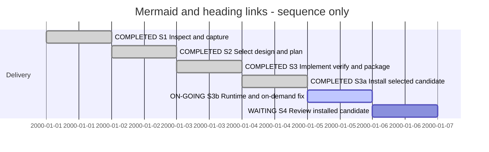

# Session — Standalone Mermaid and local heading links

## Session roadmap

| State | Step | Linked work | Authority | Outcome |
| --- | --- | --- | --- | --- |
| completed | S1 | #023 inspection/capture | Owner T001 | Captured owner diagram and source analysis |
| completed | S2 | PLAN-XFMD-0007 M1 | Owner T002/T003 | Requirements/textual design selected before code |
| completed | S3 | PLAN-XFMD-0007 M2/M3 | Owner T002/T003 | .mmd and heading links implemented; 85/85 tests; optimized local package |
| completed | S3a | MM-002 installation | Owner T004 | Exact package installed, backup retained, installed startup PASS |
| on-going | S3b | PLAN-XFMD-0008 / #025 runtime and on-demand work | Owner T007 | Release build and runtime unit PASS; native verification blocked; upstream limits pending |
| waiting | S4 | #023/#024 candidate review | No acceptance presumed | Independent review and owner disposition pending |

Latest turn T010, 2026-10-06. Dates above are sequence slots, not estimates.
Manual Session format 1; no automated transcript or enforcement claim.

| Field | Value |
| --- | --- |
| Session reference | SESSION-XFMD-0002 |
| Status | active |
| Primary card | [KB-XFMD-023](../KanBan/active/%23023--Proposal--Standalone-Mermaid-file-preview.md) |
| Current step | S3b — runtime and on-demand fix before #026 |
| Proposed next step | Finish runtime evidence and disposition remaining #025 work before any new Session/#026 |
| Execution authority | T002 implementation/build; T003 heading links; T004 installation |

## Goal and current result

Deliver raw .mmd preview/source handling and the owner-added file#heading workflow.
Implementation and local Release package are ready; review remains distinct.
[MM-001 evidence](../05--Implementation/Standalone-Mermaid/evidence/MM-001/README.md)
contains package identity, tests, source snapshot, native/PDF images and limitations.
T004 installed the exact candidate: [MM-002](../05--Implementation/Standalone-Mermaid/evidence/MM-002/README.md). No public release has occurred.

## Affected cards

| Card | Initial state | Planned disposition | Current snapshot | Actual final disposition |
| --- | --- | --- | --- | --- |
| [#023](../KanBan/active/%23023--Proposal--Standalone-Mermaid-file-preview.md) | backlog / backlog T001 | Implemented and accepted | active / gate-review | Pending review |
| [#024](../KanBan/active/%23024--Change--Local-file-heading-links.md) | active / in-progress T003 | Implemented and accepted | active / gate-review | Pending review |
| [#020](../KanBan/active/%23020--Proposal--Mermaid-compatibility-across-pipeline.md) | backlog / backlog | Separate compatibility study | unchanged | Outside this delivery |

## Plan and continuity

[PLAN-XFMD-0007](../05--Implementation/Standalone-Mermaid/Plan.md) remains active
for review; its implementation/local-package milestones are complete. Milestone
commits are deferred in the shared dirty tree; exact source artifacts are retained.

[Session 0001](session-%230001--SDP-project-navigation.md) retains its unfinished
navigation/model work. Its owner-tested installed XFMD 0.4 was backed up before T004 replaced it with
the MM-001 candidate.
The #022 model-source hold remains in force. All 331 protected SDL/SDUI/model-view
files and concurrent staged #020 were checked unchanged. No upstream SDP-vNow
files were modified. Authored model reconciliation is explicit deferred work.

## Route changes and decisions

| Date / turn | Change | Authority |
| --- | --- | --- |
| 2026-10-03 / T001 | New Session for standalone .mmd, separate from prior navigation work | Owner |
| 2026-10-04 / T002 | Execute #023 and build optimized local package | Owner |
| 2026-10-04 / T003 | Resume interrupted work and include file#heading links as #024 | Owner |
| 2026-10-05 / T004 | Install the prepared candidate with backup and receipt | Owner |

## Turn journal

### T001 — 2026-10-03 — Inspect direct Mermaid-file support

- Manual summary; host thread/turn/item identifiers unknown. Owner supplies the
  ModelGovernance VP01 .mmd path, asks whether XFMD renders it, requests a missing
  KanBan card if needed and explicitly starts a new Session.
- Skills: sdp and sdp-change-analysis; Session guide/template and board workflow.
  This is agent-reported procedure use, not automatic capture/enforcement.
- Inspection: .mmd is plain text; Mermaid recognition currently requires a Markdown
  fence. Tests that consume .mmd fixtures explicitly add that fence. Existing
  #020 concerns syntax/render compatibility; no dedicated standalone-input card
  was found. Created #023 in backlog and captured the supplied source/hash.
- Evidence: [inspection and supplied diagram](../KanBan/evidence/2026-10-03-standalone-mermaid/README.md).
  No new native run, build, implementation or installation. Board/replay and local
  links are checked at closeout; staged #020 and model sources remain unchanged.
- Next: S2 scope/design selection. This work summary is not an exact final-response
  transcript and does not claim future implementation or owner acceptance.

### T002 — 2026-10-04 — Implement #023 and build a release candidate

- Owner explicitly authorizes feature implementation and Release build using SDP.
- sdp-master/planning/worker/release applied; T001 change analysis reused.
- Selected PLAN-XFMD-0007, updated UR-047/textual blueprints before code, activated
  #023. Reuse raw-source Mermaid block preparation and existing native/PDF pipeline.
- Preserve model-source hold and shared dirty baseline/staged #020. Release means
  an optimized local candidate/package; public publication is not authorized.
- Actual results are appended at this turn's checkpoint; no future test is claimed.

### T003 — 2026-10-04 — Resume and include local heading links

- Owner requests continuation and local file links with #heading fragments.
- Applied sdp change-analysis/worker/release; extended PLAN-XFMD-0007 before code,
  captured KB-XFMD-024 and UR-048/AT-077, reconciled FUNC-008.
- Mermaid focused tests already passed; actual native and PDF images were inspected.
- Proceed with heading links, full regression and exact local Release package.

### T003 delivery checkpoint

- 85/85 configured CTest checks PASS, including 41 GUI tests. Five focused tests
  pass for Mermaid, heading links and SDP file opening. Structural/board checks
  pass; exact candidate and remaining limits are in MM-001.
- Mermaid source/edit/save/BOM/format changes, native Wrap/A4 and PDF checked.
  Absolute file#heading native click, title/slugs, relative/same-file jumps,
  dirty Cancel, Back/Forward and stale pending anchor cancellation checked.
- Release TGZ generated with SHA256; extracted executable matches the build and
  starts with the captured diagram in isolated Xvfb/temp HOME. Version remains
  0.4 with branch/count/+dirty provenance. System libraries are host dependencies.
- Plan milestones completed locally; #023/#024 active / gate-review. No independent
  approval, owner acceptance, integration commit, install, tag or publication.
- This is a manual work checkpoint, not a fabricated final-response transcript.

### T004 — 2026-10-05 — Install the prepared candidate

- Owner explicitly requests installation. Applied SDP Worker; reused MM-001 exact
  package and test evidence, without rebuilding the shared dirty working tree.
- Package checksum and extracted binary identity verified before installation.
  All 168 installed files match the package; previous files retained in the receipt's
  backup directory. Installed binary passed isolated native startup with .mmd.
- [MM-002](../05--Implementation/Standalone-Mermaid/evidence/MM-002/README.md)
  records receipt, hashes, backup and startup log. Existing user windows untouched.
- #023/#024 remain gate-review; installation is not independent review or feature
  acceptance. No publication, source/model change or integration commit.

### T005 — 2026-10-05 — Explain the 24-diagram selection limit

- Owner supplies the native status message: selection exceeds 24 diagrams.
- Read-only source investigation finds the exact error in SDP-vNow's
  SDPTool/preview.go, lines 201–202. XFMD forwards the producer error through
  SdpNavigation; this is a per-request generated selection limit, not an overall
  project/model limit or a measured XFMD rendering ceiling.
- SDPTool/Contract.md documents 24 diagrams, 128 generated files and 32 MiB per
  request. SDP/04--Design/SDPTool.md selects compact, explicitly bounded previews
  rather than unconditional full export. Git blame traces the count check to
  commit 4cdcc88a, 2026-09-25. No specific performance rationale for the number
  24 was found in the inspected design/contract.
- A broad selection can exceed the cap; selecting an individual diagram is the
  current workaround. Improving overview navigation/pagination or configurable
  budgets is a possible follow-up, not selected implementation in this turn.
- No product, upstream source or installed binary changed. S4 review remains
  pending; this factual investigation does not claim a new acceptance result.

### T006 — 2026-10-06 — On-demand limits and SDUI source navigation

- Owner rejects fixed diagram limits, asks about RAM-backed generation and
  requests an SDUI backlog item, Fyne embedding assessment and recognizable
  source-structure diagrams rather than an actual UI rendering.
- Applied SDP change-analysis/architect. Existing SDP sidebar uses temporary
  storage (normally /tmp); older navigator IPC uses XDG_RUNTIME_DIR. Observed
  mounts: /tmp xfs; /run/user/1000 tmpfs. Generated selection is on demand already.
- Created [#025](../KanBan/active/%23025--Change--On-demand-SDP-without-fixed-content-caps.md)
  for the owner decision across producer/consumer limits and bundle lifecycle.
  No cap removed: upstream SDP-vNow and installed binaries are read-only under
  current host permissions. Review existing consumer limits alongside producer.
- Created [#026](../KanBan/superseded/%23026--Proposal--SDUI-navigation-and-source-structure-views.md):
  extend the existing dynamic SDUI tab and Markdown exporter, add explicit runtime
  readiness and a separate source-structure projection. Primary recommendation:
  labelled containment flowchart, per-frame block schematic, separate binding graph.
- Fyne native X11 handle + XReparentWindow suggests a possible platform-specific
  experiment, not proven embedding. Separate Fyne window recommended initially;
  source diagrams remain independently useful. No host integration implemented.
- [Evidence and sketches](../KanBan/evidence/2026-10-06-sdui-navigation/README.md)
  record sources, API references, renderer profile limits and missing experiments.
  Sketches are illustrative, not generated authored-model views or runtime evidence.
- Cards remain backlog; no existing card superseded. S4 acceptance of installed
  #023/#024 stays pending; the new follow-up scope does not silently expand PLAN-0007.

### T007 — 2026-10-06 — Fix runtime storage and generation before #026

- Owner confirms /run/user/1000 and on-demand generation; requests the fix first,
  retaining this Session. A more expressive diagram than flat blocks is wanted
  for #026 later. No new Session or SDUI implementation is started.
- Selected PLAN-XFMD-0008 and activated #025. Requirements and FUNC-032 updated
  before code. Implement private user runtime storage, parent-viewpoint expansion,
  no cumulative 64-view stop and idle cleanup of unreachable generated bundles.
- Host restrictions keep upstream SDP-vNow, installed binaries and .git read-only.
  Tests use an isolated private runtime directory under /tmp, not the real user's
  /run tree. Current package/install remains unchanged until an authorized writable
  environment can install a tested successor.
- Actual verification and remaining scope are appended at the delivery checkpoint.

### T007 delivery checkpoint

- Release binary built; runtime unit and real-producer protocol tests pass.
  Non-GUI selection: 41/45 PASS, four failures blocked by socket/ptrace restrictions.
  GUI test assertions could not execute because Xvfb cannot bind a socket.
- [RT-001](../05--Implementation/SDP-Runtime/evidence/RT-001/README.md)
  captures candidate identity, source inputs, compressed logs and exact limits.
  Runtime allocation, lazy parent activation and retention cleanup are implemented;
  integrated native verification and installation remain pending. No new release,
  installation, upstream modification or independent approval is claimed.

### T008 — 2026-10-06 — Retry after interruption

- Owner requests another attempt. Continued the existing SDP Worker assignment.
- AF_UNIX bind under /tmp still fails with errno 1, Operation not permitted.
  Retried five focused tests: SdpRuntimeTest PASS; four GUI checks stop at Xvfb
  startup before testing application behavior. Evidence is retained in RT-001.
- PLAN-XFMD-0008 and #025 remain active. No new Session or #026 work begins.
  The next action remains native verification in a host permitting test sockets,
  followed by candidate installation and the remaining producer-limit work.

### T009 — 2026-10-06 — Name the candidate 0.5 and install

- Owner selects XFMD 0.5 and authorizes installation. Applied SDP Versioning and
  Release; updated VERSION, canonical version decision and Unreleased notes.
- Built Release/CPack 0.5.0; extracted executable matches the build, reports 0.5,
  and has no missing linked libraries. Five focused tests pass on this candidate.
- [RT-002](../05--Implementation/SDP-Runtime/evidence/RT-002/README.md) records
  hashes, source inputs, logs, release checklist and a backup/rollback installer.
- Installation cannot execute under the current write policy: ~/.local is outside
  writable roots. Prior 0.4 remains installed. Native runtime verification and
  producer limits remain pending; #025 and this Session stay active. No #026 work.

## Closeout

The Mermaid/heading-link candidate was built and installed in T004. The later
runtime increment is built but not installed; native verification is blocked by
the current host. Session remains active for #025 and pending candidate review.
Unfinished Session 0001/model work is not closed.

## T010 — 2026-10-06 — Owner selects the next Session

Owner explicitly requests [Session 0003](session-%230003--SDL-navigation-and-SDUI.md)
for SDL navigation first, then SDUI consolidation and actions. This supersedes the
earlier restriction on opening the next Session before all #025 work is finished.
It does not complete #025, PLAN-XFMD-0008, native acceptance or 0.5 installation.
The host now permits unrestricted filesystem access, but this turn performs only
backlog/session coordination. Existing permission-failure evidence remains historical.
Keep installation and runtime verification pending here; new Session has an explicit
back-reference. No goal completion or successful installation is inferred.

## Cross-session successor checkpoint — 2026-10-07

Session 0003 T003 built and installed 0.6 with [N2-001 evidence](../05--Implementation/SDL-Navigation/evidence/N2-001/README.md).
The previously blocked runtime/native checks now pass on that successor. Before
replacement, installed 0.5 and receipt 20261006T204913Z were observed; earlier notes
correctly lacked that later external installation evidence. Local runtime delivery
is verified/installed, while #025's wider producer limits and independent review
remain open. The 0.5 installation request no longer needs a separate installation.
