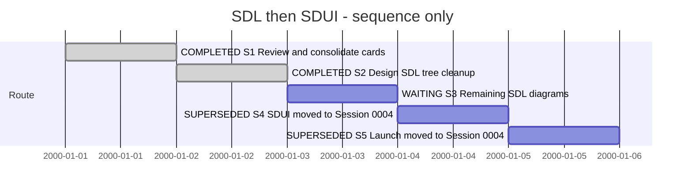

# Session — SDL navigation and SDUI workflows

## Session roadmap

Latest turn T004, 2026-10-07. Synthetic dates below are sequence only, not estimates.
Manual Session format 1; no automatic transcript or event-timeline claim.

| State | Step | Work and linked milestone | Prerequisites | Authorization | Outcome |
| --- | --- | --- | --- | --- | --- |
| completed | S1 | Card review/merge, producer inspection and handoff | Owner T001 | Explicit capture/consolidation request | #003/#026 → #027; #028/#029 created; #020/#021 extended; upstream #032 and SDUI #005 |
| completed | S2 | PLAN-XFMD-0009 N1 design/preparation | Current contracts and captured feedback | Owner T002 continues bounded design | Selected native projection; producer overview contract explicitly proposed |
| waiting | S3 | PLAN-XFMD-0009 N2 tree cleanup, then N3/N4 views | S2; producer #032, #020 renderer and #021 source dependencies | Execute under selected plan | Native/PDF evidence; all viewpoints have explicit dispositions |
| superseded | S4 | #029 action groups and #027 combined SDUI preview | S3; producer SDUI #005 | Later scoped plan | Diagram + existing text renderer in one page; disabled action states |
| superseded | S5 | Explicit Fyne launch and integrated acceptance | S4; readiness/host contract | Later scoped plan | Lifecycle/readiness tests; optional embedding disposition |

| Field | Value |
| --- | --- |
| Session reference | SESSION-XFMD-0003 |
| Status | paused |
| Primary card | [KB-XFMD-028](../KanBan/active/%23028--Change--SDL-viewpoints-and-navigation.md) |
| Current step | S3 / N3-N4 waiting for later diagram Session |
| Proposed next step | Follow Session 0004 SDUI; return to diagrams afterward |
| Execution authority | T001 authorizes new Session, review, consolidation and cross-project backlog capture; no product implementation performed |

## Goal and boundaries

Make SDL browsing useful through unique viewpoint navigation, real aggregate
views and meaningful drill-down. Then extend the current SDUI tab with a combined
composition diagram/text preview and an explicit readiness-aware Fyne launch.
Provide persistent SDP toolbar groups with contextual availability, starting with
KanBan Add/Move and SDUI Launch. Capture other issues without losing ownership.

Owner explicitly selects this new Session and prioritizes SDL cleanup over SDUI.
This replaces Session 0002's former sequencing restriction; it does not complete
that Session or #025. XFMD 0.5 was built but its last recorded installation attempt
was blocked. Host permissions are now unrestricted; no installation or validation
retry is claimed in this planning turn. Carry the outstanding installation, native
runtime verification and producer-limit work in Session 0002/PLAN-XFMD-0008.

Keep existing model-source hold (#022) explicit. No SDL/SDUI grammar/parser is
implemented in XFMD. Producer semantics and capability contracts belong upstream;
FOX navigation/rendering/actions belong here. Fyne embedding is a feasibility
question, not an established or prerequisite capability.

## Affected cards and consolidation

| Card | Role | Initial state | Current snapshot / intended outcome |
| --- | --- | --- | --- |
| #003 and #026 | Source notes | backlog | superseded by #027 with KBO-XFMD-000001; historical identities preserved |
| [#027](../KanBan/active/%23027--Proposal--SDUI-preview-and-launch-workflow.md) | Consolidated SDUI work | new | active / in-progress in Session 0004; combined page and explicit launch |
| [#028](../KanBan/active/%23028--Change--SDL-viewpoints-and-navigation.md) | First delivery to plan | new | active / in-progress; N2 delivered, N3/N4 pending |
| [#029](../KanBan/active/%23029--Change--Contextual-SDP-toolbar.md) | Shared SDP actions | new | backlog; persistent SDP/KanBan/SDUI/Sessions groups and enabled-state rules |
| [#020](../KanBan/active/%23020--Proposal--Mermaid-compatibility-across-pipeline.md) | Renderer dependency | backlog | backlog; exact VP07 reproduction and proper use-case support added |
| [#021](../KanBan/active/%23021--Change--Dynamic-SDP-tabs-labels-and-source-opening.md) | Existing source navigation | active / gate-review | Earlier whole-file delivery remains under review; new exact-span scope is explicitly unimplemented and must be selected separately |
| #015, #017, #019 | Adjacent work | existing | Not merged: direct design preview, XFMD model maintenance, shared rendering |
| #025 | Previous Session work/dependency | active / in-progress | Unfinished; on-demand ownership and remaining producer limits carry forward |
| KB-SDP-032 | External viewpoint producer study | backlog | Existing card extended with actual owner feedback |
| KB-SDUI-005 | External SDUI producer handoff | new | backlog; combined projection + readiness facade, links existing SDUI #003/#004 |

Local review confirmed only #003/#026 are duplicate aspects suitable for full
consolidation. Upstream SDUI capability and text-fidelity cards remain independent
owners, not copies to absorb into XFMD. Existing cards with wider responsibilities
retain those responsibilities and cross-link the new delivery.

## Plan register

[PLAN-XFMD-0009](../05--Implementation/SDL-Navigation/Plan.md) is a planned
ImplementationPlan with current-branch/milestone Git policy. N1 design is prepared;
N2 is delivered in T003 as installed 0.6. N3/N4 require actual producer/renderer/source-span
work. Existing PLAN-XFMD-0008 retains earlier runtime/installation obligations.

## Turn journal

### T001 — 2026-10-06 — Consolidate SDUI and prioritize SDL navigation

- Capture: manual summary of visible owner request; host message IDs unknown.
- Skills used: local SDP entrypoint, Change Analysis and Planning for capture and
  route selection; upstream SDP entrypoint/document workflow for producer cards.
  This is agent-reported use, not automated process-enforcement evidence.
- Owner: new Session; merge SDUI notes; combined diagram + existing text render;
  persistent SDP/KanBan/SDUI/Sessions toolbar groups with disabled unavailable tools;
  initial KanBan Add/Move and Fyne Launch; SDL cleanup takes precedence. Remove A
  group duplication, meaningful use-case and VP07 overviews/details, sequence and
  conditions where supported, remove inert placeholders, exact source-line links.
- Source inspection identified producer-generated abstraction/reference duplication
  and consumer cycle/depth markers. Installed gh sdp sdui-preview successfully
  generated EditorWorkspace's text layout/content, proving the facade exists.
- [Evidence](../KanBan/evidence/2026-10-06-session3/README.md) preserves the export,
  original owner VP07 Mermaid and reported error. No native rendering reproduction
  or root-cause diagnosis is claimed. Official Mermaid usecase-beta documentation
  checked; native XFMD support needs independent compatibility work in #020.
- Merged #003/#026 into #027 with typed ledger lineage, preserved sources under
  superseded and retargeted current links. Created #028/#029. Extended #020/#021;
  kept #015/#017/#019 and upstream language cards separate for their real scope.
- Created upstream KB-SDUI-005 and updated KB-SDP-032 instead of duplicating it.
  No product/model changes, commit, install, publication or acceptance in this turn.
- Next: S2, bounded SDL tree/overview design. Work summary, not a fabricated final
  response transcript. Validation: XFMD board PASS (29 cards, 113 card events, 14 management records);
  upstream schema/replay/lineage PASS (361 card events), touched card paths match;
  new Session/card file links PASS; git diff --check PASS in both repositories.
  The staged #020 content remains staged unchanged; its new notes are unstaged.

### T002 — 2026-10-06 — Bounded SDL navigation design

- Owner says continue, following the announced bounded design step. Applied SDP
  Architect and Planning; no product implementation performed by the design role.
- Selected native display projection compatible with current discovery, distinct
  origin/canonical/occurrence identity, reference-specific actions and diagnostics.
  Source inspection found original-reference targets can be lost to generic VP11.
- Prepared PLAN-XFMD-0009, #028 queued. Requirements and FUNC-032 distinguish the
  planned tree/overview behavior from current implementation and earlier evidence.
- Overview targets are a concrete optional producer proposal, not current support.
  Supplied it to existing KB-SDP-032 with every viewpoint's disposition. Current
  producer has per-use-case/feature detail graphs and actual VP08 scenario sequences;
  no inferred scenario order/conditions or silently invented source associations.
- N2 tree cleanup is next. N3/N4 coordinate proper overviews, renderer and exact
  source navigation. No new model sources, install, release or independent approval.
- Validation PASS: local board (29 cards, 114 card events, 15 management records),
  blueprint (38/75), implemented symbols (297), upstream ledger schema/replay/lineage
  and diff whitespace checks in both repositories. The planned helper is not
  counted as implemented. N1 evidence records actual graph target differences;
  native behavior is not certified by those checks.
- This is a work summary; verification concerns documents and source inspection.

### T003 — 2026-10-07 — Implement, build and install 0.6

- Owner authorizes implementation and local build/install as XFMD 0.6.
  Applied SDP Worker, Versioning and Release; PLAN-XFMD-0009 started and #028
  activated. Preserve unrelated staged #020 and the authored-model hold.
- Implementing N2 display projection and occurrence identity, original reference
  actions, inert placeholder removal and expansion-box dispatch. Release includes
  earlier runtime changes; rerun their previously blocked native tests now that
  host permissions permit sockets. N3/N4 producer contracts remain explicit gaps.
- Actual tests, package identity and installation receipt are appended at checkpoint;
  no future pass or install is claimed in this initial turn entry.

### T003 delivery checkpoint

- N2 implemented and installed as XFMD 0.6. [N2-001](../05--Implementation/SDL-Navigation/evidence/N2-001/README.md)
  records exact source/binary/package identity, 88/88 CTest PASS including 42 GUI,
  inspected native screenshots, all 168 installed hashes and native installed smoke.
- Previously blocked runtime/history checks now pass on this successor candidate.
  Corrected test setup for horizontal box visibility and initial refresh settling;
  retained initial failure logs and all meaningful behavior assertions.
- Observed pre-install version was 0.5 with receipt 20261006T204913Z; it had been
  installed after our earlier blocked attempt. 0.6 installation backs it up.
  Existing user windows unchanged; no public release/tag or integration commit.
- N2 does not complete N3/N4: aggregate views, proper use-case/VP07 rendering,
  exact source spans and model-derived scenario/condition detail remain pending.
  #025 producer limits and later #027/#029 remain open. Next: N3 coordination.

## Closeout

Open. N2 is implemented, verified and installed as 0.6. Producer overviews,
remaining renderer/source-span work and later SDUI/Fyne integration remain.

## T004 route change — 2026-10-07

Owner explicitly chooses a new SDUI Session now and diagrams afterward.
[Session 0004](session-%230004--SDUI-workflow.md) supersedes this Session's S4/S5
execution route. S3 N2 remains delivered as 0.6; N3/N4 remain unfinished and
await the later diagram Session. This Session is paused, not completed. Card
#028 and PLAN-XFMD-0009 retain their active lifecycle with execution deferred.
#027 moves to active under PLAN-XFMD-0010. No diagram scope is silently dropped.
