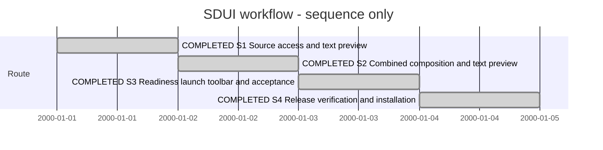

# Session — SDUI browsing and prototype launch

## Session roadmap

Latest turn T007, 2026-10-07. Synthetic dates are sequence only, not estimates.
Manual Session format 1; no automatic conversation capture.

| State | Step | Work / plan | Prerequisites | Authority | Outcome |
| --- | --- | --- | --- | --- | --- |
| completed | S1 | PLAN-XFMD-0010 U1: SDUI source access and existing text preview | Current discovered model/entry identities | Owner T001 | U1-001: 3/3 tests and inspected native source/text output |
| completed | S2 | U1b: composition diagram plus text preview | Producer KB-SDUI-005 projection | Owner explicit clarification T001 | U4-001: combined mindmaps/text and exact SDUI source links |
| completed | S3 | U2/U3: readiness, explicit Fyne launch, #029 SDUI action and native acceptance | Producer contract and usable host | Selected SDUI portion only | U4-001: real preflight/Fyne launch, errors and toolbar acceptance |
| completed | S4 | U4: release/install and review disposition | S3 | Owner T002 requests 0.7 installation | U4-001: 89/89 tests, exact package/install receipt; #027 gate-review; SDL Session0005 created |

| Field | Value |
| --- | --- |
| Session reference | SESSION-XFMD-0004 |
| Status | completed — selected implementation and installation |
| Primary card | [KB-XFMD-027](../KanBan/active/%23027--Proposal--SDUI-preview-and-launch-workflow.md) |
| Snapshot date | 2026-10-07 |
| Current step | None; S1–S4 delivered |
| Proposed next step | Session0005: select producer contracts and SDL viewpoint diagrams; T005 card handoff is applied |
| Execution authority | Owner asks to create a new Session and start SDUI; diagrams follow in another Session |

## Goal and decisions

Make the existing SDUI tab useful for inspecting original source, generating the
existing text prototype and explicitly launching a supported Fyne prototype.
Distinguish static preview, runnable local prototype and SDL-connected execution.
All SDP action groups should remain visible in SDP mode with unavailable tools
disabled; the SDUI action is this Session's selected #029 portion. KanBan mutation
services remain separate unselected work.

Owner clarification T001: include SDUI composition diagrams alongside the text
preview now; defer only SDL viewpoint diagrams. This supersedes the initial
all-diagrams-deferred assumption before any diagram implementation. Preserve the
combined-page requirement and producer ownership under KB-SDUI-005. Create the
later SDL diagram Session after this SDUI work is disposed.

Authored model-source hold under #022 remains in effect. No native embedding,
widget parity or SDL callback execution is inferred from the Fyne host's existence.
T001 left installed XFMD0.6 untouched. T002 explicitly supersedes that boundary and installs 0.7 with a 0.6 backup.

## Affected cards

| Card | Role | Initial state | Planned final disposition | Current snapshot | Actual final |
| --- | --- | --- | --- | --- | --- |
| #027 | Primary combined SDUI workflow | backlog / backlog | SDUI delivery combined composition/text and launch evidence | active / gate-review | Installed 0.7; awaiting review |
| #029 | Shared toolbar dependency | backlog / backlog | Select SDUI portion after launch contract | active / in-progress | SDUI portion delivered; KanBan mutations remain |
| #028 and #020 | Diagram work context | active / in-progress; backlog | Continue in later diagram Session | Unchanged lifecycle | SDL successor Session0005; KB020 retains nested-layout repro |
| #021 | Source-navigation boundary | active / gate-review | Whole-file source reuse now; exact spans retained | active / gate-review | SDUI exact spans delivered; broader SDL spans remain Session0005 |

## Plan register

| Plan | Type / readiness | Canonical lifecycle | Evidence |
| --- | --- | --- | --- |
| [PLAN-XFMD-0010](../05--Implementation/SDUI/Plan.md) | ImplementationPlan / implementation delivered; review pending | active for review | [U4-001](../05--Implementation/SDUI/evidence/U4-001/README.md) |
| [PLAN-XFMD-0009](../05--Implementation/SDL-Navigation/Plan.md) | Context only; N2 shipped in 0.6 | active, N3/N4 deferred | N2-001; no new diagram implementation |

## Turn T001 — 2026-10-07

Owner request (manual summary): create a new Session, start SDUI, then create
another Session for diagrams. Host turn IDs and exact message timestamp unknown.

Used SDP entry, planning and worker roles. Recovered the installed 0.6 boundary,
selected PLAN-XFMD-0010, activated #027 and preserved unrelated shared edits.
Existing SDPTool sdui-preview delegates to the SDUI Markdown exporter. Found a
consumer gap: source association and source-opening guards accept only SDL.
Selected U1 to support typed SDUI source/frame associations without changing
producer semantics, original model sources or generated diagram behavior.

Inspected upstream SDUI/go/cmd/sdui-fyne/main.go: standalone desktop build,
-entry and -watch flags before source filename, local prototype handlers,
symbolic SDL bindings left unbound. No host on PATH and no JSON readiness facade.
U2 must resolve the producer contract rather than infer runtime readiness from
syntax validation. No upstream edits or launch implementation yet. Owner clarification keeps SDUI
composition in this Session as U1b; only SDL diagrams are deferred.

Outcome: implemented U1 source access; targeted build and 3/3 tests passed.
Inspected native source-editor and text-preview screenshots. Board, blueprint,
symbol (302 implemented callees) and layer checks pass. Source snapshots/hashes
and logs are in U1-001. No install or version change; no independent review.
Next: U1b producer-owned composition diagram plus existing text preview, then
readiness/Fyne launch and contextual toolbar. Session and #027 remain active.

## Turn T002 — 2026-10-07 (execution)

Owner authorizes all remaining SDUI work and build/install as XFMD 0.7. Apply SDP
architect, worker and release skills. Extend producer composition/provenance and
check contract, bundle tools without changing gh sdp, integrate explicit Fyne
launch and contextual toolbar, then run native/release checks. No SDL viewpoint
work or authored model changes. Outcome and final roadmap follow verification.

### T002 outcome and closeout

Manual work summary; host turn/message IDs and final-response text are not captured.
Implemented all selected SDUI work and installed owner-named XFMD0.7. All 89 tests
(43 native GUI), producer race/facade checks and real Fyne/PDF inspection passed.
[U4-001](../05--Implementation/SDUI/evidence/U4-001/README.md) identifies both source
trees, exact package/helper hashes, install backup and receipt. Existing user
windows were preserved; restart XFMD to load the newly installed executable.

Composition uses readable per-container mindmaps after native inspection rejected
overlapping nested flowchart clusters. The valid group-ID mapping fix is included;
remaining geometry issue is captured under KB020 for the SDL diagram Session.
Fyne owns a separate window, local bindings only. No SDL execution or embedding.
The gh extension and authored model sources remain unchanged.

KB027 and upstream KB-SDUI-005 are gate-review, with no independent approval
claimed. PLAN0010 retains active canonical state for that review disposition;
implementation/install steps are complete. KB029 retains unselected KanBan mutation
work, with its SDUI portion delivered. Broader SDL source spans and viewpoints
remain #021/#028/#020 and PLAN0009 N3/N4. This closes the selected SDUI Session's
implementation/install goal with explicit residual dispositions, not owner acceptance.

The owner-selected next route is [Session0005](session-%230005--SDL-viewpoint-diagrams.md).
No SDL diagram implementation or further version/install is claimed in this turn.

## Turn T003 — 2026-10-07, widget ownership and XM-M2 follow-up

Manual owner request: determine whether the invalid widget entries are unfinished
XFMD/SDUI work or obsolete BoxUI material; remove XM-M2 only if obsolete. Screenshot
shows evidence/XM-M2/fixtures sources in the SDUI navigation tab. Used SDP entry and
change-analysis skills; host turn IDs unknown.

Outcome: XM-M2 is historical positive/negative probe evidence, not widget
implementation. Preserve its files/hashes and reproducibility links. SDUI widget
expansion stopped at producer study/handoff to backlog KB-SDUI-003. Current
button/input/svg profile and Fyne ownership are unchanged. Live gh sdp discovery
confirms historical fixtures are offered as models; capture source-classification
follow-up on KB027, with a discovery excerpt under KanBan/evidence.
No product/producer edits or deletion, no new tests/build/install needed for this
analysis. SDUI0.7 delivery remains complete and its review disposition remains;
new discovery-scope refinement is recorded separately in the card. Session0005
remains the proposed SDL diagram successor, execution not started.

## Turn T004 — 2026-10-07, SDUI upgrade dependency clarification

Owner asks whether completing KB-SDUI-003 and releasing gh sdp is sufficient.
Checked SduiTools.cpp, SdpNavigation.cpp and SduiWorkflow.cpp: installed XFMD0.7
prefers privately bundled sdui-preview/sdui-fyne for preview, readiness and launch;
discovery uses the configured SDPTool/gh sdp adapter. Updating gh sdp alone does
not update those helpers. New widget support requires the chosen SDUI scope plus
updated producer discovery and matching helper binaries. Repackage XFMD with the
new helpers and verify the native workflow; C++ changes are only needed if its
contracts/required presentation change. Absolute helper overrides exist for tests.
KB-SDUI-003 does not mandate every historical probe widget. Excluding evidence
fixtures from normal model discovery remains a separate refinement, independent
of widget completion. No implementation, release or lifecycle change this turn.

## Turn T005 — 2026-10-07, expanded widget card and XM-M2 decision

Manual owner summary: update KB-SDUI-003 with all widgets it should implement;
XM-M2 may remain in the ordinary model overview. Host turn IDs unknown. Reused
SDP entry/change-analysis context and read upstream instructions/entrypoint and
current card/study. No plan or product implementation selected by this request.

Prepared a concrete producer inventory and per-family behavior/acceptance for
all ten XM-M2 widget categories plus numeric input, existing controls/properties,
viewport scrolling, typed bindings and producer/host/preview integration. Preserve
the limited-prototyping boundary and require new evidence rather than modifying
frozen XM-M2 probes. The owner supersedes the earlier exclusion recommendation;
KB027 and the maintained gap register now explicitly retain normal discovery.

Outcome: local documentation and decision capture complete. Upstream card update
is prepared but **not applied** because the current filesystem policy only permits
writes in XFMD and /tmp. [Handoff](../KanBan/evidence/2026-10-07-sdui-widget-scope/README.md)
contains the full card, exact patch and baseline hashes. Scratch application
matches the prepared bytes; live upstream source remains unchanged. No upstream
worklog/ledger transition is fabricated. Apply from a writable SDP-vNow session,
append a live reviewed event and validate the board to finish that part of the
request. SDUI0.7 remains installed; no product tests/build/install needed here.

Next: apply the prepared external card update; Session0005 remains the separately
selected future SDL-diagram route. This documentation handoff does not reopen the
completed SDUI implementation/install steps or start widget implementation.

## Turn T006 — 2026-10-07, apply producer widget-card update

Owner reports restored write access; current host policy confirms it. Reused SDP
entry/change-analysis and board context. The live KB-SDUI-003 matched the recorded
baseline exactly, so applied the prepared patch without changing concurrent work.
Appended actual upstream reviewed event EVT-KB-SDUI-000018 and worklog; backlog state remains.
The card now contains the complete widget inventory, interaction/export/host
acceptance, consumer upgrade requirements and the owner's decision to retain
XM-M2 in normal discovery. No widget implementation or publication was selected.

The T005 handoff is now applied; metadata and KB027 reflect the completed transfer.
Validated upstream KanBan schema/replay/lineage, affected card metadata/placement,
local board and diff whitespace. Source/test/runtime files are unchanged; no build
needed. No upstream governance Session is attributed this external discussion.
Next product-work route remains Session0005. Host turn IDs unknown; manual summary.

## Turn T007 — 2026-10-07, completion and next-work review

Owner asks whether the current Session activities are finished and which XFMD
cards can follow. Reviewed the SDUI plan, Session0005 and live local cards; this
is a status/priority review, not new implementation selection. Reused SDP context.

S1–S4 implementation, verification and installation are delivered as0.7; the
follow-up KB-SDUI-003 update is applied. KB027/PLAN0010 still record owner/independent
review disposition, not unfinished selected code. General SDUI widget expansion
belongs to the producer backlog and is outside this completed Session delivery.

Recommended next route remains Session0005: KB020 renderer compatibility/repro
first, with KB028 overview/detail workflows as the main outcome and KB021 exact
SDL provenance links. Start with existing repros and live producer-contract recovery;
aggregate overviews and SDL span support need producer coordination, not a guessed
consumer-only implementation. KB029 KanBan Add/Move remains separate actionable
work after selecting its management-service contract. KB025 retains producer
content-limit work despite delivered local runtime/lifetime fixes. KB015 direct
editable .design/preview, KB019 shared rendering/Kitty and KB017/#022 modeling/
baseline reconciliation remain later work with their recorded prerequisites.

Do not mistake all active cards for absent functionality: standalone Mermaid
(#023), heading links (#024), dynamic tabs/whole-file sources (part of #021),
SDUI (#027) and much of #014/#025 already have delivery evidence. Final review/
closeout remains distinct from implementing the explicitly retained remainder.
No card state or plan execution changed and no build was needed for this review.
