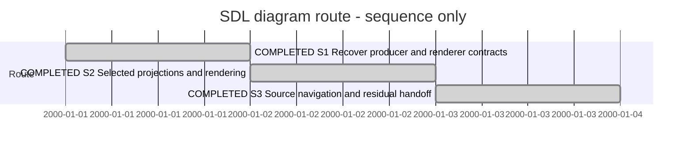

# Session — SDL viewpoint diagrams and source navigation

## Session roadmap

Latest turn T021, 2026-10-19 (Europe/Oslo). Created during Session0004 T002 closeout. Sequence only; dates are not estimates.
Manual Session format 1; no automatic capture.

| State | Step | Plan/work | Prerequisite | Authority | Outcome |
| --- | --- | --- | --- | --- | --- |
| completed | S1 | PLAN-XFMD-0009 N3: recover producer KB-SDP-032 and renderer KB020; select bounded contracts | SDUI delivered in 0.7 | Owner asks for diagram Session after SDUI | N3a-001: live contracts, exact reproductions, mindmap correction and verified fork candidate |
| completed | S2 | N3: adopt verified renderer candidate and complete use-case/feature viewpoint projections | S1 | Owner diagram intent; concrete design must follow evidence | N3/N4 selected projections, routing and continuous reading delivered; large-print publication retained under KB020/028 |
| completed | S3 | N4: exact SDL source links, source-supported sequences/conditions, all-viewpoint disposition, native/PDF acceptance | S2 and producer provenance | Existing selected plan | N4-001: native source/detail/PDF verification; all-viewpoint and residual disposition recorded |

| Field | Value |
| --- | --- |
| Session reference | SESSION-XFMD-0005 |
| Status | completed — selected implementation round; explicit residual handoffs below |
| Primary card | [KB-XFMD-028](../KanBan/active/%23028--Change--SDL-viewpoints-and-navigation.md) |
| Snapshot date | 2026-10-19 |
| Current step | S3 complete: N4 implementation and verification; producer fde2239 on main-based successor |
| Proposed next step | Integrate/release the producer candidate; select large-print and remaining-viewpoint successors from the disposition record. Session0006 remains held |
| Execution authority | Owner T021 selects completion of the Session implementation. No main merge/release/install selected |

## Goal and boundaries

Complete the meaningful SDL viewpoint behavior already specified in
[PLAN-XFMD-0009](../05--Implementation/SDL-Navigation/Plan.md) N3/N4 and its design.
Recover current producer work before implementation. Viewpoint overviews should
include all source-supported actors/use cases or architectural feature context;
detailed selections should expose source-supported relationships, sequences and
conditions without inventing semantic information. Links must reach exact source
when producer provenance supports it. Preserve the 0.6 tree cleanup and 0.7 SDUI.
Authored .design/.sdui hold under #022 remains until the owner changes it.

## Affected cards and plans

| Card | Role | Current state | Intended outcome / final disposition |
| --- | --- | --- | --- |
| #028 | Primary SDL viewpoint workflow | active / in-progress | Selected implementation delivered; large-print acceptance and release integration remain under the active card |
| #020 | Mermaid compatibility and layout | active / in-progress; staged baseline preserved | Required use-case/VP07 fixes delivered; broader compatibility/nested-layout/publication scope remains active |
| #021 | Source provenance/navigation | active / gate-review | Exact SDL source jumps delivered by N4; existing card review state preserved |
| Producer KB-SDP-032 | Cross-project projection contract | active / in-progress | VP01/VP07 and focused source/detail producer committed; release integration and other-viewpoint proposals remain |

Canonical plan: PLAN-XFMD-0009, ImplementationPlan, active; N2 delivered in0.6,
N3 selected projections delivered with large-publication successor still open; N4
implementation verified. No broad plan/card completion is inferred from Session closure.

## Handoff from Session0004

SDUI0.7 is installed; [U4-001](../05--Implementation/SDUI/evidence/U4-001/README.md)
records exact verification. Native nested-group ID ordering was corrected, while
flowchart geometry still overlaps in the captured SDUI containment repro. KB020
owns that remaining finding; SDUI uses mindmaps and does not depend on a fix.
Original Libavoid non-orthogonal edge report and use-case notation support also
need the existing producer/renderer evidence recovered before any new claims.

## Turn journal

Initial handoff was created during Session0004 T002 from the owner’s explicit
successor instruction. T001 below starts execution; host turn IDs unknown.

### T001 — 2026-10-07

Owner authorizes the recommended diagram round. Loaded SDP planning/worker
entrypoints and recovered governing design. Activate KB020 and preserve concurrent
work. Source inspection finds no overviewTarget contract in current SDPTool;
SDUI source links are delivered but aggregate SDL projections/source spans remain
producer coordination. Begin exact VP07/nested-layout reproduction. Outcome below
will distinguish verified behavior from proposals; no release/install selected.

### T001 outcome — 2026-10-08

S1 delivered: live33 viewpoints have no overviewTarget; original VP07 failure and
nested overlap are reproduced in actual native preview/PDF. Gantt axisFormat and
gitGraph init first-error boundaries are recorded. Mindmap quoted-label fallback
is corrected in XFMD;22 interpreter tests and12 affected CTests (four GUI) pass.
Native/PDF inspection confirms labels, shapes and hierarchy. Normal build passed.

VP07 candidate is implemented in isolated Mermaid fork commit e79d8f9caf649995a5db5e54b0ea5d6b7fab8221. Exact
Pango metrics reproduce edge11; one bounded Libavoid spacing retry yields all12
nodes/18 edges. Twelve existing backend tests plus the new regression pass.
An isolated C++ consumer with candidate debug FFI renders and exports successfully
within the unchanged production deadline; inspected native/PDF evidence retained.
Normal dependency pin and installed0.7 are unchanged; no public fork push/release
or independent review claimed. Adopting the candidate into the normal version-bound
dependency remains S2, not a completed installed fix. Nested hierarchy remains open.

[N3a-001](../05--Implementation/SDL-Navigation/evidence/N3a-001/README.md) contains
source/binary hashes, fork patch/commit, exact observations, commands and images.
Preserved the shared dirty tree and staged #020 snapshot while moving its live
card active. Document validation caught the upstream-card transfer snapshot’s
relative links; renamed that verbatim payload to .md.txt without byte changes.
Authored models remain held. No version bump or installation requested/performed.
Session remains active; full #020/#028/#021 work is not complete.

### T002 — 2026-10-08

Owner asks to continue. Use SDP Worker and a bounded architecture decision for
source transport. Adopt the exact tested fork commit as a checksummed repository
archive; preserve the old .deps source without patching it. Add original VP07 C++
regression and isolated bootstrap integrity tests. No release/install/publication
or authored-model change selected. Normal build and native/PDF verification pending.

### T002 outcome

N3b adopted the exact fork into the normal Release build via a checksummed bundled
source archive. Six bootstrap cases and the C++ original VP07 regression pass;
13 affected CTests pass, including four GUI tests. Native preview and PDF inspected
with all 12 nodes/18 relations retained. Cargo.lock and installed0.7 unchanged.
[N3b-001](../05--Implementation/SDL-Navigation/evidence/N3b-001/README.md) records
sources, binaries, commands and images. Shared index/baseline preserved; no public
push, new release, installation or independent review. S2 remains on-going because
proper use-case rendering and producer VP01/VP07 overviews are not implemented.
Next coordinate/select KB-SDP-032's explicit overview/source contracts and the
corresponding consumer notation; do not synthesize targets or model facts in XFMD.

### T003 — 2026-10-08

Owner continues S2. SDP Architect/Planning select a bounded usecase-beta profile;
Worker implements native actors/ellipses/boundaries and explicit UML relationships
through typed records. Official syntax checked; the fork has no source parser for
this family, so XFMD retains syntax ownership. Producer overviewTarget is still
absent; do not fabricate an aggregate capability. Normal build/native verification
is in progress. Source-model hold and no release/install/publication remain.

### T003 outcome

N3c adds the bounded usecase-beta profile through typed records and native fork
actors, ellipses, boundaries and UML relationships. Visual review rejected initial
actor attachments at invisible text-box edges; the final candidate attaches to
actual glyph strokes, avoids actor captions and preserves system membership.
All four directions with/without boundaries are covered in the fork. Fourteen
fork tests and 13 affected CTests pass; native preview and PDF were inspected.
[N3c-001](../05--Implementation/SDL-Navigation/evidence/N3c-001/README.md) preserves
initial rejected output and final candidate evidence, including limitations.

Normal Release build is updated; installed0.7 and Cargo.lock remain unchanged.
No root-wide commit, public push, release, installation, authored-model edit or
independent approval. S2 and KB020/028 stay active. The next producer step is
specified in [Producer-Handoff](../04--Design/SDL-Navigation/Producer-Handoff.md):
overviewTarget and complete VP01/VP07 projections, with actual exercises-scenario
links and explicit missing-condition handling. Upstream code was not modified.
The notation prerequisite is delivered; complete viewpoints are not yet delivered.

### T004 — 2026-10-08

Owner asks to continue. Loaded SDP Architect/Planning/Worker and producer entry/
document workflow; select N3d VP01 overview as a complete vertical increment before
VP07's mode-specific architecture work. Inspected both dirty shared repositories;
preserve unrelated SDUI/governance changes. Adopt optional overviewTarget and
projection=overview explicitly in producer contract. Implementation and actual-tool
native/PDF verification pending; no new release/install or authored-model changes.

### T004 outcome

N3d delivers the first VP01 overview through SDL projection, SDPTool overviewTarget
and native XFMD activation. Complete actor/use-case inventory includes isolated
items; functionality realization stays separate. Real XFMD source retains one
actor, 11 use cases and 11 pursues relations. Native inspection selected LR after
rejecting the unreadably wide TB fan-out. Query metadata stays in selection.json.
The tall real diagram also exposed a one-ULP paged-height overshoot; DiagramPlacement
now bounds the final height and has a synthetic plus real PDF regression.
Go viewpoint/documents and SDPTool facade tests pass. Native and affected consumer
checks pass, including Enter/click, expansion-only, older/empty producer fallback,
stale/foreign targets and PDF export. The first new GUI attempt lacked explicit
X11 focus; its failing log is preserved alongside corrected passing evidence.

[N3d-001](../05--Implementation/SDL-Navigation/evidence/N3d-001/README.md) records
source/binary identity, initial failures, final tests and inspected native/PDF.
Producer KB-SDP-032 is active for the selected work unit; its other feedback remains
open. Shared staged/dirty work preserved; no authored system model edit, root-wide
commit, independent approval, release, installation or gh upgrade. Installed0.7
is unchanged. S2/KB028 stay active: VP07, proper focused use-case notation with
source-supported scenarios/conditions, and exact SDL source navigation remain.

### T005 — 2026-10-08

Owner asks to continue. Select N3e VP07 logical overview and explicit per-mode
activation. Loaded SDP entrypoint, Architect, Planning, Worker and Traceability;
recovered both shared working trees and preserved their existing changes.
Acceptance and mode distinction are recorded in the current design before code.
Outcome pending; no release or installation selected.

### T005 outcome

N3e implements lazy VP07 logical overview and named-mode targets. All declared
System/container/unit structure is retained. Feature keys annotate real owners and
selected-mode containers through proven Functionality paths; the legend and table
retain all Features, contributions and allocation gaps. No cross-mode union or
invented direct relation. Native Enter/selection exercises both mode targets.
Ten affected CTests pass (five GUI); SDL viewpoint/documents pass and the SDPTool
facade suite passes with one documented pre-existing SDUI test excluded. That test
also fails in an isolated copy with N3e edits removed: UIPreview uses Combined,
while the all-family test compares against Markdown. Do not claim full producer
suite success or change another workstream's acceptance in this increment.

The literal graph timed out; the adopted annotation projection renders the real
XFMD model (23 architecture nodes, 19 contains edges, 140 proof annotations and
137 facts) and exports an eight-page vector PDF. Small-fixture rendering is readable.
Real-model full-view labels remain small at fit-to-width / A4. Grouping disconnected
nodes was explored but not adopted: it improved native width while worsening PDF
pagination. Large-overview reading is still an acceptance gap owned by KB020/028;
no overall visual acceptance or Session completion is claimed.

[N3e-001](../05--Implementation/SDL-Navigation/evidence/N3e-001/README.md) records candidates, tests and the explicit visual gap. KB028/020 and producer KB032 stay active. Shared changes and authored models preserved; no broad commit, independent review, release or installation.

### T006 — 2026-10-09

Owner asks whether visual approval is requested and asks to launch the development
version for testing. Clarified that visual validation remains open, not that an
owner approval gate is being imposed now. Reused the SDP entrypoint and Session
continuity routine; no new implementation unit selected.

Verified build-ui/xfmd and /tmp/xfmd-n3e-sdptool against N3e candidate SHA-256
records, then launched that exact pair on the owner desktop (DISPLAY=:0), rooted
at this project. XFMD_SDP_TOOL overrides only this process's producer. PID 355181;
runtime log /run/user/1000/xfmd-development/session0005-preview.log. Process is
running; xwininfo is unavailable, so no separate window-inspection claim is made.
No installation, release, model edit or owner acceptance claimed.
Owner can test SDP -> SDL -> XfmdDesktop, VP01/VP07 and VP07's NormalDesktop
mode target. Large-overview readability and focused/source successors remain
open; record actual feedback before changing their disposition.

### T007 — 2026-10-09

Owner supplies failing VP07 Mermaid and asks what mode NormalDesktop means.
Loaded SDP Change Analysis; reused Session and renderer authority. Reproduced
the exact label-attachment error in native/PDF using the candidate launched for
owner testing. Recorded a distinct routing regression on KB020/028; prioritize
it before diagram acceptance. Explained the existing model mode from declarations
and allocation facts; no UI runtime switch or new modeling decision is inferred.

[N3f-001](../05--Implementation/SDL-Navigation/evidence/N3f-001/README.md) contains
target, generated source, exact error, hashes and bounded repair handoff.
No code/dependency/model changes, release or installation in this diagnostic turn.

### T008 — 2026-10-09 (discussion)

Owner asks for a reminder of the purpose of SDL `in mode`. Checked the current
Structural Core and Channel/Scenario profiles in SDP-vNow. Explained that Mode
qualifies design facts by execution/operating context: required interfaces,
Functionality-to-Container allocation and Channel participation; a Scenario
selects one such context with runs-in. Ownership remains unchanged across modes.
The profile example places ValidateModel in CommandLineHost during Inspection
and InteractiveHost during LiveEditing. There is no implicit mode inheritance
or automatic runtime transition supplied by these structural declarations.
NormalDesktop remains the sole context in the present XFMD model. This is a
semantic clarification, not authorization to remove or redesign modes. The
reproduced VP07 routing repair stays next; no product/model changes this turn.

### T009 — 2026-10-09

Owner confirms NormalDesktop is useful preparation for future design changes and
authorizes continuation. Preserve that mode and the authored-model hold. Select
the N3f routing repair under KB020/028. Reuse Change Analysis and load Worker;
retain strict attachment validation and bounded routing/cancellation. Capture
exact native font metrics in a fork regression before changing placement.

### T009 outcome

N3f repairs the reported DocumentReferences VP07 detail by using actual measured
caption extents to bound the existing single expanded-placement retry. Node/edge
semantics, strict attachment validation, four label orders, three route transactions,
engine selection and deadlines remain unchanged. Fork commit
04c6ea7146dab35ef5fca0c204e65763e52f99d7 is adopted through a checksum-pinned
repository archive; all 1,292 regular files match the clean fork and extracted input.

Fifteen affected fork integration tests and three strict attachment unit tests pass.
The normal Release build passes 14 selected CTests, including six native GUI tests.
Actual native/PDF inspection confirms the reported diagram renders all 12 nodes and
15 edges; its vector PDF has one page and all declaration labels are present.

A sweep of all ten existing XFMD VP07 feature details renders nine successfully.
ChapterNavigation still fails with an ambiguous label on edge7; the identical
failure reproduces in the pre-fix normal probe. This is an existing additional
case, not a passed gate or a regression introduced by the new spacing rule.
Prioritize that fixture next, then large-overview reading, focused use-case/scenario
projections and N4 exact source navigation. KB020/028 and Session0005 remain active.

[N3f-002](../05--Implementation/SDL-Navigation/evidence/N3f-002/README.md) records
exact candidates, failures, tests and native/PDF inspection. Owner-approved
NormalDesktop is preserved. A new development window launch was attempted on DISPLAY=:0
(PID 381022) using build-ui/xfmd and the existing candidate SDPTool. That process
had exited at closeout with an empty log; cause unknown. The prior development
window (PID 355181) remains on the old binary and was not closed or replaced. Installed0.7 remains unchanged. No independent review/publication.

### T010 — 2026-10-09

Owner authorizes continuation. Select the remaining ChapterNavigation VP07 caption
ambiguity under KB020/028, using the SDP Worker role and exact native measurements.
Preserve strict routing/attachment checks, NormalDesktop, authored-model hold and
the current release. Reproduce before repair, then verify the fork and native/PDF
consumer and repeat the ten-detail sweep. Evidence: N3g-001 (in progress).

### T010 outcome

ChapterNavigation now renders with all 10 nodes and 12 edges. The fork registers
caption-identity exclusion polygons alongside existing attachment obstacles;
strict final validation, routing bounds and deadlines remain unchanged. All ten
actual XFMD VP07 feature details render in the normal Release candidate. Sixteen
fork integration tests, five geometry tests and 14 selected CTests (six GUI) pass.
Native preview and one-page vector PDF were inspected; all declaration labels
are present. The installed 0.7 and authored models remain unchanged.

[N3g-001](../05--Implementation/SDL-Navigation/evidence/N3g-001/README.md) records
the exact candidate, reproduction and inspected evidence. KB020/028 remain active.
Next: large-overview readability, then focused use-case/scenario projections and
N4 exact source navigation. No new release/install, owner acceptance or independent
review. Existing desktop processes were not restarted; working build is updated.

### T011 — 2026-10-10

Owner requests installing the current development version as0.8. Use SDP Release
and Versioning; verify unchanged N3g sources before selecting the version-only
product change. Build, test, package, retain an installed0.7 backup, install and
verify the exact artifact. Existing diagram scope stays open; no public publication
or producer upgrade selected. Release evidence:R08-001 (in progress).

### T011 outcome

Built and installed the current development candidate as XFMD 0.8 (package 0.8.0).
Full 91/91 CTest passed, including 44 GUI tests. All 210 installed files match the
verified package; previous 0.7 files are backed up. Installed Mermaid and SDUI/Fyne
smoke checks passed. [R08-001](../05--Implementation/SDL-Navigation/evidence/R08-001/README.md)
records source/package hashes, actual receipt, checklist and release notes.
Only VERSION differs from N3g's captured source inputs. Existing windows were not
restarted; newly launched XFMD uses 0.8. No producer/gh/project-SDP upgrade or public
publication. S2 and KB020/028 remain active; next work is still large-overview
readability, followed by focused projections and exact SDL source navigation.

### T012 — 2026-10-10: owner-directed pause

Owner requests pausing this Session and creating a new Session for automatic
discovery of gh sdp functionality under KB-XFMD-030. Session0005 is paused, not
completed or superseded. Preserve the 0.8 installation and all verification.
KB020/028 return from in-progress to ready as a recorded paused handoff; their
active placement and PLAN-XFMD-0009's active lifecycle are retained. No new plan
state is invented. KB021 and external producer records keep their own dispositions.

Resume on owner request at S2: improve large-overview readability, then focused
use-case/scenario projections and N4 exact source navigation. Authored-model hold
remains. New focus: [Session0006](session-%230006--Discoverable-SDPTool-actions.md).
Planning and Traceability skills used for routing/management records only; no
product changes or new verification claims.

### T013 — 2026-10-10: resume diagram work

Owner authorizes returning to Session0005 where work can proceed now. KB030 and
Session0006 remain on hold for the released upstream JSON API. SDP Architect,
Planning and Worker select N3h: an opt-in full-size diagram reading mode in Wrap,
using the existing scene, horizontal viewport and document zoom. Fit remains the
default; A4/PDF remain bounded. This does not depend on producer action discovery.
Preserve source-model hold and shared dirty/staged work. Verification pending;
no installation, release, publication or independent approval selected.

### T013 outcome

N3h is implemented and built: View → Full-size diagrams (Wrap), existing
horizontal/vertical scrolling and document zoom, default fit and unchanged A4/PDF
geometry. 19/19 affected CTests pass (11 GUI), plus the captured actual VP07 native
workflow. Visual inspection confirms readable panned detail; the full canvas still
requires navigation. Initial native fixture failure used a cursor byte inside an
em dash; corrected valid byte boundaries preserve the original assertions.
[N3h-001](../05--Implementation/SDL-Navigation/evidence/N3h-001/README.md) records
exact candidate, scoped patch, logs, initial failure and screenshots.

Read-only dependency recovery finds installed SDPTool 2.2.0 but zero overviewTarget
fields, so the earlier producer overviews are not established installed behavior.
Current upstream source composition also requires per-file provenance in N4; a
model revision must not be treated as a file hash. Producer-Handoff now records
these concrete successors. Producer source was not modified during its concurrent
work. Session0006/KB030 remains held for the released JSON action API.

Session0005 and KB020/028 remain active: readable overview publication, focused
use cases/linked scenarios, exact source navigation and remaining viewpoint
dispositions are unfinished. Installed 0.8, source-model hold and shared staged
baseline are preserved. No new release/install, root-wide commit, publication,
independent review or owner acceptance is claimed.

### T014 — 2026-10-10: clarify producer ownership

Owner asks whether overview advertisement is planned and tracked in SDP-vNow.
Read-only inspection confirms active/in-progress KB-SDP-032, Evaluate SDL
viewpoints through integrated XFMD navigation, and its linked producer work unit
SDP/05--Implementation/SDL/ViewpointNavigation/Plan.md. N3d/N3e already describe
VP01/VP07 candidate implementation and checks. Current tree.go contains the
overviewTarget field/advertisement and is modified; viewpoint/overview.go exists
as an untracked file and advertises VP01/VP07. Thus this is existing local work,
not a feature that still needs to be proposed from scratch. Integration, current
candidate verification and release remain distinct from that implementation.
The previous turn's installed 2.2.0 discovery result remains the installation
observation; no new discovery, tests, producer edits or release in this turn.
No duplicate card is needed. KB030/PLAN-SDP-0024 action discovery remains separate.

### T015 — 2026-10-10: clarify implementation responsibility

Owner asks which agent implemented the upstream overview candidates and who must
finish/integrate them. The recorded N3d/T004 and N3e/T005 work was performed from
this XFMD conversation under this Session, including the producer changes in
SDP-vNow. It is not an awaited independent implementation by another agent. Broad
commits were deferred to preserve the shared dirty/staged producer baseline;
scoped patches and candidate evidence were retained. This workstream owns
preparing its changes and stating remaining checks; whoever performs SDP main
integration must explicitly include/reconcile KB-SDP-032's candidate files.
Integration/release is separate from remaining broader viewpoint work. The owner
question does not authorize a new commit, merge, push or release; none performed.

### T016 — 2026-10-18: isolate and commit the producer delivery

Owner says continue after authorship/integration clarification. Recovered both
shared working trees and used SDP entrypoint, Planning, Worker and Verifier.
Selected N3i: isolate this workstream’s N3d/N3e producer changes on a branch based
on current producer HEAD, preserving concurrent SDUI/governance work and indices.
The producer work-unit branch policy records this bounded change in approach.

Outcome: local commit `cc7b52f84f05fdef63efc1a305023a12347026ad` on
`sdp/xfmd-viewpoint-overviews` contains the scoped code, current contract/requirements
and work-unit evidence. SDL viewpoint/documents and the complete SDPTool root
package pass without exclusions; added composed-source provenance/freshness
coverage passes. Actual XFMD discovery/select produces the 12-node VP01 and
23-node logical/NormalDesktop VP07 overviews. Native XFMD Enter/click/expansion,
mode and PDF workflow passes; native screenshots inspected.

[N3i-001](../05--Implementation/SDL-Navigation/evidence/N3i-001/README.md) identifies
commit, binary/source hashes, logs and initial fixture/history-import failures.
The isolated branch deliberately excludes old KB032 board/ledger fragments: their
partial append after later committed IDs violates namespace order. Shared history
is preserved and the integration handoff explains its separate reconciliation.
A concurrent producer Session0010 commit advanced shared HEAD to 0918098 without
changing the captured product inputs. No other agent work was staged or restored.

Shared KB032/work unit now point to the exact commit and retain in-progress for
broader projection/source work. Commit is ready for integration review; no main
merge, public push, release, installation, independent approval or broad Session
completion. KB030/Session0006 remains held. Next integrate the scoped producer
commit with its retained dirty copies/history and verify the eventual released
contract; remaining focused views, sources and publication retain their scope.

### T017 — 2026-10-18: distinguish integration from remaining producer work

Owner asks what remains in producer KB032 and conditionally requests the XFMD
changes if only merging remains. Recovered the current card, isolated commit,
shared producer HEAD (0918098), handoff, selected design and consumer code using
SDP entrypoint/Worker guidance. N3i's isolated worktree is clean; no newer shared
producer commit changes the recovered boundary.

The full card still needs focused use-case/scenario/condition projections, an
exact revision-aware source-link contract, other viewpoint dispositions and
integrated readability/owner feedback. Only the bounded VP01/VP07 overview
candidate is ready for integration/release. Its XFMD protocol and native activation
are already implemented and were tested in N3i; no duplicate consumer change is
needed. Updated Producer-Handoff with a current responsibility/status matrix.
Dependent N4 source navigation must follow the producer contract; sources.json
is not that contract. No new code, tests, merge, release, installation, lifecycle
transition or acceptance is claimed. Prior N3i evidence remains the test record.

### T018 — 2026-10-18: check against fetched main

Owner asks whether there are no conflicts with updated main. Fetched origin/main
and ran non-mutating merge-tree checks against e8760d331933361ab631ef0d52c20e87268a22b3.
The assumption is false: full branch integration has 14 conflicted files,
including inherited SDUI and management history. Isolating only cc7b52f's delta
with its parent as merge base narrows conflicts to SDPTool/Contract.md and
SDPTool/tree.go. Previous candidate tests did not establish merge cleanliness.
The isolated worktree remains clean; no actual merge/cherry-pick, conflict
resolution, runtime test, release or installation performed. Exact commands,
exit codes and conflict paths are in N3i-001/main-conflict-check.json.
Next integration must reconcile the overview contract/tree behavior with current
main, then test the combined candidate. Broader KB032 scope remains unchanged.

### T019 — 2026-10-18: N3j current-main compatibility

Owner authorizes making our change compatible with current main before further
feature work. SDP Planning/Worker/Verifier selected. Concurrent-work preflight
records clean main/actions worktrees at e8760d3, clean N3i at cc7b52f and retained
shared producer changes at 0918098. Session0011 T010 records Actions integration
as completed; its schema additions must be preserved. Owner instruction selects
this workstream to reconcile only cc7b52f on current main, not to integrate old
branch ancestry or modify another worktree. Scoped green verdict and input hashes:
N3j-001/preflight.json. No new management IDs allocated in the producer.

BranchPolicy for N3j: new isolated branch sdp/xfmd-viewpoint-overviews-main based
on fetched e8760d3; CommitPolicy milestone. Preserve original cc7b52f/branch as
history. Resolve the two scoped conflicts additively, verify full affected Go
modules and native XFMD workflow, then recheck merge cleanliness against fetched
main. No push, main merge, release or installation is selected. Outcome pending.

### T019 outcome

Committed `ecd9dcd5cd95fb2b1f323cea96da1776659b2513` on `sdp/xfmd-viewpoint-overviews-main`, directly above
freshly fetched main e8760d3. Kept all main assignment/blueprint Node fields and
Programs/Blueprints/Actions contract sections; added our overview fields/sections.
New integration regression proves direct/Actions discovery payload equality and
execution of returned VP01/VP07 logical/mode targets with detail targets retained.
Full SDL and SDPTool modules, vet, native XFMD overview/PDF workflow and actual
XFMD overview byte comparison pass. Screenshots inspected, PDF labels verified.
Post-commit merge-tree exits 0 with the candidate tree; branch clean, one commit
ahead of recorded main. N3j-001 records exact inputs, patch, logs and receipt.

Preflight input hashes and heads remained unchanged for all four original relevant
worktrees before commit. Only own shared handoff/card worklog updated afterwards;
no product/index edits in those worktrees, no ledger history import. Original
cc7b52f remains preserved; use the new branch for integration. Updated producer
plan/handoff, KB032 worklog, XFMD plan and Session pointers. No main merge, push,
release, installation, independent review or broader KB032 completion. Remaining
producer scope from T017 is unchanged; the requested merge-compatibility task is done.

### T020 — 2026-10-19: ProjectGovernance overlap check

Owner asks whether working with blueprints can conflict with Session0007. Reused
SDP Session continuity and concurrent-work preflight for a read-only code check.
Fetched main remains e8760d3. Current clean PG worktree is 9a770ea; Session0007
T023 follows delivered PGL2-C2c owner-input/decision applicability and retains
future dispatch prerequisites. Its maintained ownership separates work selection,
collaboration and disposition from model artifact management.

Compared our exact main-based candidate ecd9dcd with PG changes since the same
main: zero overlapping changed paths. Non-mutating merge-tree exits 0. Captured
heads, paths, clean PG status and output in N3j-001/project-governance-overlap.json.
Our delivery adds SDL overview projections and an optional navigation target; it
does not implement blueprint lifecycle, approval or dispatch. The prior conflict
resolution preserved existing blueprint/assignment fields rather than modifying
their behavior. No combined-runtime test was performed this turn, so a clean Git
forecast is not a claim of verified combined product behavior.

Future XFMD consumption of blueprint/assignment actions must preserve producer
ownership: PG owns workflow/decisions/dispatch, model/blueprint services own their
artifacts and evidence, and XFMD presents advertised results/actions. Repeat
preflight when either branch or shared contract changes. No code, PG records,
merge, release, installation or card state changes. Session goal/next delivery
remain unchanged; this outcome clarifies current compatibility and future scope.

### T021 — 2026-10-19: complete the remaining Session implementation

Owner requests continuing and finishing this Session. Recovered the selected
N3/N4 scope using SDP entrypoint, Planning, Architect, Worker and Master guidance
(without delegation). Select focused use-case/scenario generation and exact
revision-bound SDL source navigation as the remaining integrated implementation.
Keep the producer on sdp/xfmd-viewpoint-overviews-main, milestone commits; XFMD
retains its selected current branch and exact diff evidence for the shared baseline.
No authored production model edit, PG/blueprint lifecycle, main merge, release or
installation is selected. N4-001/preflight.json records current worktree identities.
Design/contract is recorded before code. Outcome pending; Session remains active.

### T021 outcome — selected implementation completed with residual handoffs

N4 delivers focused actor/use-case diagrams, explicit exercises-linked scenario
sequences, separate realization, unspecified conditions and exact original-source
selection for single/composed SDL. Changed dependencies, invalid paths/ranges,
UTF-8 boundaries, dirty cancel and history are verified in native XFMD. Fixed
24/48 diagram-count caps were recovered and removed; 50-diagram coverage passes.

Producer commit fde2239f0cd8202f6221394d2a3dae84828edb10 follows ecd9dcd on
sdp/xfmd-viewpoint-overviews-main. Complete SDL/SDPTool suites and vet pass. Full
XFMD build passes; 92/93 initial CTests passed and the only failed blueprint-format
check passes after its heading correction. All 12 SDP/source checks pass again
with the final producer. Native source/overview captures and PDF were inspected.
[Evidence](../05--Implementation/SDL-Navigation/evidence/N4-001/README.md) preserves
exact source/binary hashes and logs. This is same-context verification, not an
independent review or owner acceptance.

PG advanced during execution to 3e407d6; rechecked clean worktree and no overlapping
changed paths. Final merge-tree against both current main e8760d3 and PG passes.
No merge, push, release, install, authored model change or PG mutation occurred.
XFMD's shared staged/dirty baseline is preserved; its complete product snapshot
is evidence, not a broad commit or a claim all changes belong to this turn.

The Session implementation round is closed with an explicit
[VP01–VP11 and residual disposition](../04--Design/SDL-Navigation/Viewpoint-Disposition.md).
Large-overview A4 print readability remains a real KB020/028 acceptance gap;
other aggregate proposals/legacy export notation remain producer KB032; broader
Mermaid/nested-layout issues stay KB020 and remaining resource guards stay KB025.
These are assistant-recorded handoffs, not owner waivers or completed work.
PLAN-XFMD-0009 and the broad cards stay active; #021 retains gate-review.
The next integrated release must include the producer contract before claiming
these capabilities work with the installed gh extension. Session0006 is still held.

### T022 — 2026-10-19: integration and successor

Owner authorizes merging the current delivery and continuing to the next viewpoint.
N3j/N4 are merged and pushed to SDP main as 5ca0e90; the merged tree exactly equals
tested fde2239 and targeted integration checks pass. [Session0007](session-%230007--Architecture-viewpoint.md)
selects VP02 as the next bounded increment. Session0005 stays closed; no release
or installation is claimed. Shared producer ledger history remains separate.
