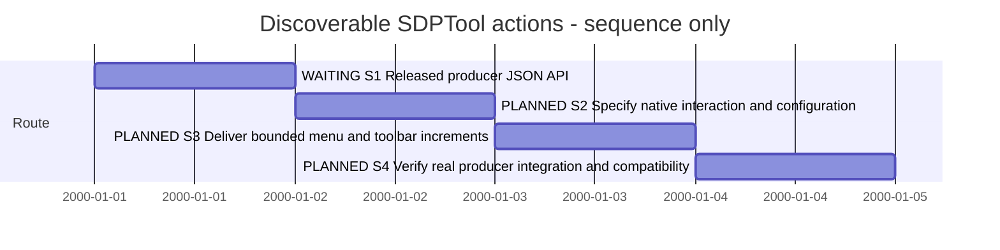

# Session — Discoverable gh sdp actions in XFMD

## Session roadmap

Latest turn T002, 2026-10-10 (Europe/Oslo). Manual Session format 1.
Sequence only: synthetic dates express ordering, not delivery estimates.

| State | Step | Work and plan milestone | Prerequisites | Authority | Completion evidence / outcome |
| --- | --- | --- | --- | --- | --- |
| waiting | S1 | Recover the released PLAN-SDP-0024 JSON API and select the XFMD consumer plan | Producer implementation/verification, intended main integration and new release | Owner T002 defers KB030 until the producer release | Pending: actual release/schema and JSON responses; pushed proposal alone is insufficient |
| planned | S2 | Define menu, shared action state, parameter forms, Preferences ToolBar tab and personal configuration | S1 supported contract and explicit unresolved choices | KB030 desired outcome; detailed design not yet selected | Pending: requirements/architecture/design and acceptance examples |
| planned | S3 | Implement selected runnable increments through existing native application boundaries | S2 and corresponding producer capability | Implementation scope follows the selected plan | Pending: working dynamic menu and configurable toolbar without per-action menu code |
| planned | S4 | Verify released JSON API via signed gh-sdp path, downgrade/context/error behavior | Runnable XFMD candidate and released producer | KB030 acceptance | Pending: exact candidate and native workflow evidence; record release authority separately |

| Field | Value |
| --- | --- |
| Session reference | SESSION-XFMD-0006 |
| Status | paused |
| Primary card | [KB-XFMD-030](../KanBan/onHold/%23030--Proposal--Discoverable-SDPTool-menu-and-toolbar.md) |
| Snapshot date | 2026-10-10 |
| Current step | S1 waiting for the producer API, main integration and release |
| Proposed next step | On the release handoff, verify PLAN-SDP-0024 JSON capability/version and prepare the consumer plan |
| Execution authority | Owner T002 defers KB030 until the producer is integrated and released; XFMD must use its JSON API |

## Goal and acceptance boundary

XFMD discovers supported operations exposed through gh sdp/SDPTool and presents
those actions through a dynamic SDPTool menu and a personal toolbar. Supported
new actions should not need hardcoded menu/toolbar additions merely to appear.
Existing tab discovery is a useful foundation; it does not establish an action
catalogue, typed forms or mutation-service availability.

KB030 is the authoritative intent. The planned outcome includes:

- Versioned action metadata: stable IDs, groups, labels/descriptions, icon keys,
  typed input/output and context/availability. Inspect a supported machine-readable
  contract; do not scrape help text or assume the installed runtime implements it.
- One validated action/invocation path shared by menu, toolbar and keyboard.
  Bind actual project/model/blueprint/assignment selection. Use typed argument
  vectors, never document-supplied shell snippets. Metadata is not authorization.
- A Preferences ToolBar tab for selecting/reordering actions; personal editable
  configuration outside project sources, using stable IDs and optional icon
  overrides. Preserve dormant/unknown IDs across older runtime use; define reset,
  duplicate and malformed-input behavior. XFMD supplies icons and a generic fallback.
- Distinguish unsupported actions (hidden, configuration retained) from advertised
  but temporarily unavailable actions (visible, disabled with a reason). Reconcile
  this with KB029's persistent groups and existing SDUI Launch behavior.
- Supported Blueprint operations and assignment transitions, with explicit
  work-state versus readiness/freshness, revision conflicts, idempotence and
  structured failure results. Producer services own canonical mutations/history.
- Native verification against the released PLAN-SDP-0024 JSON API through the
  normal signed gh-sdp path; cover refresh, downgrade, unsupported schemas/forms,
  generic icons and errors while preserving selection.

Complex interactions may require adapters; discovery does not imply an arbitrary
future operation can be fully rendered or safely executed by a generic form.
S1 must identify these limits rather than promise universal compatibility.

## Affected cards

| Card | Role | Initial lifecycle / CardState | Planned final disposition | Current snapshot | Actual final disposition |
| --- | --- | --- | --- | --- | --- |
| [KB030](../KanBan/onHold/%23030--Proposal--Discoverable-SDPTool-menu-and-toolbar.md) | Primary | backlog / backlog | Completed after selected outcome and verification | onHold / onHold | Pending |
| [KB029](../KanBan/active/%23029--Change--Contextual-SDP-toolbar.md) | Related toolbar contract; reuse delivered SDUI behavior | active / in-progress | Explicitly reconcile any selected overlap; retain unfinished KanBan mutation scope | Unchanged; context only in T001 | Pending in its own work record |
| external:PLAN-SDP-0024 / KB-SDP-051 | Producer JSON action catalogue and invocation; Session0011 | Not re-inspected in this turn | Agreed producer/consumer contract and corresponding evidence | External handoff from KB030; state unknown | External authority |
| external:KB-SDP-050 | Blueprint service capabilities | Not re-inspected in this turn | Supported trial operations verified before exposure | External handoff from KB030; state unknown | External authority |

Related discovery/source implementation under KB014/021 is reused as a baseline,
not reopened or claimed complete by this Session. KB030 is not merged into KB029;
record any later consolidation with preserved lineage and explicit residual scope.

## Plan register

| Local ref | Plan type and document | Readiness | Canonical lifecycle | Depends on | Outcome |
| --- | --- | --- | --- | --- | --- |
| P1 | ArchitecturePlan or DesignPlan to be selected after S1 evidence; no ID allocated | planned | Not registered | Released PLAN-SDP-0024 API and native responsibility analysis | One proportionate authoritative plan with BranchPolicy/CommitPolicy and bounded acceptance |

The Session is a roadmap, not a replacement typed implementation plan. Do not
create empty phase documents or start a blanket refactor. Preserve the shared
dirty working tree and staged cards. Select an isolated implementation branch or
other explicit Git policy when the plan is ready; no commit/push/merge/publication
is inferred from Session creation.

## Predecessor and resumption

[Session0005](session-%230005--SDL-viewpoint-diagrams.md) is paused at owner request.
Installed XFMD 0.8 / [R08-001](../05--Implementation/SDL-Navigation/evidence/R08-001/README.md)
is the product baseline. Preserve its remaining large-overview, detail/scenario
and exact-source work. This Session does not absorb or complete those obligations.
Authored .design/.sdui hold under KB022 remains until the owner changes it.
No new version, installation, gh upgrade or external-project edits are selected here.

## Route changes and decisions

| Date / turn | Previous route | Change and reason | Authority | Affected scope |
| --- | --- | --- | --- | --- |
| 2026-10-10 / T001 | Session0005 diagram work after 0.8 installation | Pause predecessor; prioritize automatic gh sdp action discovery | Explicit owner request naming KB030 | Session0005 paused; KB030 queued for S1 |
| 2026-10-10 / T002 | S1 queued for contract recovery | Wait for producer API, main integration and release; consume its JSON contract | Owner dependency decision | Session0006 paused; KB030 onHold |

## Producer release dependency — T002

Use the JSON API delivered by external PLAN-SDP-0024 for KB030. Wait for its
implementation/verification, the intended SDP-vNow merge to main and a new release
that exposes the contract through gh sdp. At resumption verify actual version,
schema, catalogue and invocation behavior before consumer design/implementation.
No release version/date is known. A contract proposal or pushed branch is not the
release gate. The primary card owns the restart conditions and review checkpoint.

The owner reports external Session0011, PLAN-SDP-0024 and pushed commit a9edf28;
those statuses were not independently verified in this documentation-only turn.
Session0005 stays paused. No alternate work or automatic monitoring is selected.

## Turn journal

### T001 — 2026-10-10: establish Session

Manual summary of the visible owner request; host thread/turn/item IDs and any
routine-run identity are unknown. Owner asks to pause the current Session and
create a new Session for automatically discovering gh sdp functionality in XFMD,
using KB030. Loaded SDP Planning and Traceability for the routing update.

Reviewed KB030 and its overlap with KB029, the current Session, local Session
format and planning/card lifecycle. Created this roadmap and linked the primary
and related cards. S1 is next; KB030 changes from backlog to queued without an
implementation-state claim. No producer capability was freshly verified, no
application code changed and no new test/release result is claimed. This is a
work summary, not an automatically captured final response.

### T002 — 2026-10-10: wait for released JSON API

Manual summary: owner shares upstream Session0011 progress, contract proposal,
PLAN-SDP-0024 and pushed commit a9edf28, then proposes waiting for API completion,
main integration and a new SDPTool release. Owner specifies that XFMD must use
that JSON API for KB030. Continue the loaded SDP Planning/Traceability method.

Pause Session0006; move KB030 from backlog/queued to onHold/onHold with explicit
restart conditions. Update current references and append the management move.
No implementation, upstream verification, upgrade or diagram-session resumption.

## Closeout

Paused pending the producer release gate. On resumption: S1 verifies the released
JSON API and prepares a bounded consumer plan. Completion requires
an explicit disposition for the selected outcome and every included work item;
Session0005 remains paused until the owner resumes it.

T001 setup validation: local Session links resolve; board verification passes with
30 cards and 145 card events, including schema/replay/CardState/placement checks.
Git diff whitespace check passes. Documentation-only turn; no product tests needed.

T002 validation: board schema/replay/placement check passes (30 cards, 146 card
events); current local links resolve and no stale backlog address for KB030
remains in Markdown. Git diff whitespace check passes.
