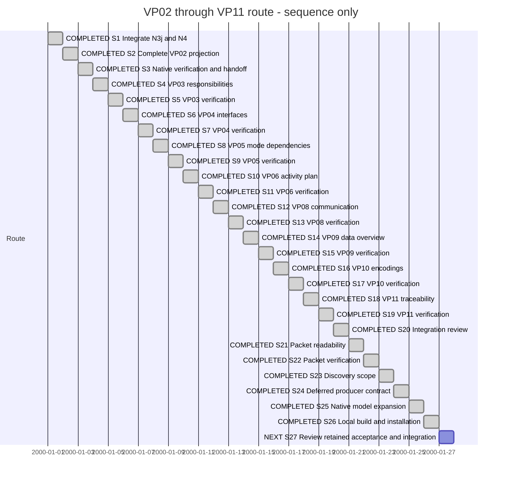

# Session — architecture and dependency viewpoints

## Session roadmap

Latest turn T012, 2026-10-21 Europe/Oslo. Manual format 1; sequence only, not estimates.

| State | Step | Work / authority | Evidence |
| --- | --- | --- | --- |
| completed | S1 | Owner asks to merge the existing tested delivery into main | SDP main merge 5ca0e90, pushed; tree equals fde2239, targeted integration checks pass |
| completed | S2 | Owner asks to continue with the next viewpoint; select VP02 from the existing matrix | cdf4437: complete VP02 inventory/register with full producer tests |
| completed | S3 | Verify the selected producer/native workflow and record successor | N5-001: native/PDF/source/reading and 12 affected tests pass |
| completed | S4 | Owner continuation selects VP03 from the disposition matrix | 63da7ae: complete responsibility/capability projection |
| completed | S5 | Native producer/consumer verification and handoff | N6-001: full producer and 12 consumer tests; native/PDF/reading |
| completed | S6 | Owner continuation selects VP04 | 85d62f2: complete interface consumption projection |
| completed | S7 | Verify native VP04 and hand off candidate | N7-001: full producer, 12 consumer tests, native/PDF/reading |
| completed | S8 | Owner selects VP05 | 3b3d935: mode index and isolated dependency views |
| completed | S9 | Verify mode isolation and native workflow | N8-001: producer suites, 12 consumer tests, native/PDF |
| completed | S10 | Owner selects VP06 | 76fc87f: activities and separate prerequisites |
| completed | S11 | Verify activity plan and native workflow | N9-001: full producer suites, 12 consumer tests and native/PDF |
| completed | S12 | Owner selects VP08 | d677d70: channel partitions and scenario index |
| completed | S13 | Verify communication topology | N10-001: producer suites, 12 consumer tests, 40 actual native/PDF diagrams |
| completed | S14 | Owner selects VP09 | 6b80b40: data/storage and contract inventory |
| completed | S15 | Verify data/storage overview | N11-001: full producer, 12 consumer tests, native/PDF/source checks |
| completed | S16 | Owner selects VP10 | f1c3342: Encoding inventory and packet layouts |
| completed | S17 | Verify Encoding/packet overview | N12-001: producer, 12 consumer checks, native/PDF/source; visual defect retained in KB020 |
| completed | S18 | Owner selects VP11 | 486b29d: properties, complete registries and reported gaps |
| completed | S19 | Verify traceability overview | N13-001: producer suites/vet, 12 consumer checks, exact native source selection and complete actual PDF |
| completed | S20 | Review N5–N13 integration and retained cards | N14-001/preflight.json: main/PG committed forecasts clean |
| completed | S21 | KB020 packet readability correction | Fork 49bb0ee and checksum-pinned dependency |
| completed | S22 | Verify native/PDF geometry and hand off residuals | N14-001: 7 fork tests, 24 CTests, inspected native/PDF |
| completed | S23 | Select bounded KB025 discovery policy/work | N15 design: preserve all sources; defer model graphs |
| completed | S24 | N15a producer discovery/expansion service | e194721; N15-001 full producer, 12 compatibility checks and actual checkout probe |
| completed | S25 | N15b native model expansion | N15b-001: 94/94 tests and actual project native VP02 |
| completed | S26 | Owner-authorized XFMD 0.9 and matching producer installation | N15b-001: exact package, installed bytes, backup and native/private-producer checks |
| next | S27 | Review retained acceptance, integration and resource guards | KB020/025/028/032 remain open; local installation boundary complete |

| Field | Value |
| --- | --- |
| Session reference | SESSION-XFMD-0007 |
| Status | on-going |
| Primary card | [KB028](../KanBan/active/%23028--Change--SDL-viewpoints-and-navigation.md) |
| Snapshot date | 2026-10-21 |
| Current step | S25/S26 completed: N15b verified and XFMD 0.9 with matching SDPTool installed |
| Proposed next step | S27: review retained integration, resource guards and diagram acceptance under KB020/025/028/032 |
| Execution authority | Owner continuation through selected viewpoints; T012 explicitly authorizes autonomous completion through local XFMD and required SDPTool build/install |

## Goal and plan

Deliver the [N5 logical architecture overview](../04--Design/SDL-Navigation/N5-Architecture-Overview.md)
through the existing producer/native contract. Reuse active [PLAN-XFMD-0009](../05--Implementation/SDL-Navigation/Plan.md)
and producer ViewpointNavigation work unit. No new plan identity or process migration.
Producer BranchPolicy: sdp/xfmd-vp02-overview from merged main 5ca0e90;
CommitPolicy: scoped N5 milestone. XFMD stays on its shared current branch with
exact changed-test/source evidence. No production model edits or release/install.

T002 extends this goal with the N6 responsibilities/capabilities overview. The
producer branch is sdp/xfmd-vp03-overview stacked on cdf4437, with a scoped N6
milestone commit and the same preserved model/publication boundaries.

T003 extends the goal with the N7 interface consumption overview. Producer branch
sdp/xfmd-vp04-overview stacks on 63da7ae with a scoped milestone commit. Existing
source, publication and concurrent-work boundaries remain unchanged.

## Card dispositions

| Card | Initial / current state | Selected outcome / final disposition |
| --- | --- | --- |
| KB-XFMD-028 | active / in-progress | VP02–VP06 and VP08–VP11 candidates; broader publication/viewpoint scope retained |
| KB-SDP-032 | active / in-progress in shared producer checkout | Integrate N3j/N4; implement next selected projection; remaining aggregates stay open |
| KB-XFMD-020 | active / in-progress | N14 corrects narrow packet labels; broader renderer/publication gaps retained |

## T001 — owner continuation

Manual summary; host thread/turn IDs unknown. Owner requests merging current
work to main and continuing with the next viewpoint. Loaded SDP entrypoint,
Planning, Architect and Worker plus concurrent-work/document procedures.
Interpret the merge scope as the previously prepared producer commits ecd9dcd
and fde2239, preserving XFMD and SDP-vNow shared dirty work. Merge 5ca0e90 is
pushed to origin/main, with identical tested tree and passing targeted checks.

Select VP02 from the existing per-viewpoint matrix. No overlap with current
ProjectGovernance/coordination changed paths. Preserve production model hold.
Outcome pending; evidence in N5-001. This journal is a work summary, not a captured
final response or independent approval.

### T001 outcome

N3j/N4 is integrated and pushed on SDP main as 5ca0e90. N5 is implemented and
pushed separately as cdf4437 on sdp/xfmd-vp02-overview. It advertises VP02 through
the existing contract, retains all structural declarations/contains proofs and
original detail identities, and adds an exact-source structural register. No
XFMD product code change is needed; its native integration test is extended.

Full SDL/SDPTool suites and vet pass, as do all 12 affected consumer CTests.
Actual XFMD generation/rendering retains 23 nodes/19 edges; PDF retains all labels.
Full-size/pan/zoom reading is verified. [N5-001](../05--Implementation/SDL-Navigation/evidence/N5-001/README.md)
holds exact identity, preflight, merge receipt, tests and inspected artifacts.
No independent review, new release/install, authored model edit or PG mutation.
The remaining large-print and other-viewpoint obligations are unchanged.

Session goal is complete as a verified candidate and integration of the preceding
delivery. KB028 and shared producer KB032 remain active for their broader scope;
PLAN-XFMD-0009 remains active. N5 was not merged automatically under the existing
delivery's merge instruction. VP03 is the next proposed increment.

## T002 — continue with VP03

Owner says to continue after VP03 was named next. Reopen/extend this Session with
S4/S5, retaining completed S1–S3. Use SDP Planning/Architect/Worker and concurrent
preflight. Select [N6 design](../04--Design/SDL-Navigation/N6-Responsibilities-Overview.md),
stacked branch sdp/xfmd-vp03-overview from cdf4437, milestone commit. Preserve
main, PG and shared producer/XFMD work; no new merge/release/install. Core owns,
realizes and provides semantics are distinct. Outcome pending in N6-001.

### T002 outcome

N6 is committed/pushed as 63da7ae on sdp/xfmd-vp03-overview, stacked on cdf4437.
Complete VP03 responsibilities/capabilities preserve source proofs and old details.
All SDL/SDPTool suites, vet and 12 affected consumer tests pass. Actual XFMD has
23 structural nodes/19 edges, 28 responsibilities and no declared capabilities;
native/PDF and full-size reading checks pass. Long PDF table identifiers wrap;
large-print acceptance remains open. [N6-001](../05--Implementation/SDL-Navigation/evidence/N6-001/README.md)
records exact candidate, concurrent checks, tests and inspected artifacts.

This extended Session round is complete. The plan and KB028/KB032 remain active
for their broader scope. VP04 interfaces is next proposed. No N5/N6 merge,
release/install, production model edit, PG mutation or independent approval.

## T003 — continue with VP04

Owner says to continue after VP04 was named next. Extend this Session with S6/S7
while retaining completed S1–S5. Loaded SDP entrypoint, Planning, Architect and
Worker, document workflow and concurrent-work preflight.
[N7 design](../04--Design/SDL-Navigation/N7-Interfaces-Overview.md) selects direct
interface consumption with full inventory and no inferred provider/transport.
Branch sdp/xfmd-vp04-overview stacks on 63da7ae; milestone commit. Main remains
5ca0e90; no PG/coordination path overlaps. Production model hold remains.
Outcome pending in N7-001. No merge/release/install or independent approval.

### T003 outcome

N7 is committed/pushed as 85d62f2 on sdp/xfmd-vp04-overview, stacked on 63da7ae.
Complete interface inventory/consumption proofs and source register are delivered
with preserved legacy table behavior. Full SDL/SDPTool suites, vet and 12 consumer
tests pass. Actual XFMD renders 14 interfaces, 12 consumers, 24 edges; all node
names survive PDF. Full-size reading passes. The initial native test assumed a
branch; inspection confirmed existing Right-on-leaf activation, now explicitly
tested alongside Enter and retained branch expansion checks. Verifier skill was
loaded for candidate/evidence assessment.

[N7-001](../05--Implementation/SDL-Navigation/evidence/N7-001/README.md) records
exact inputs, failures/correction, final tests and inspected artifacts. Fit-view
packing/large-print readability remains open. This extended Session round is
complete; PLAN-XFMD-0009 and KB028/KB032 remain active for broader scope. VP05
mode-specific dependencies is proposed next. N5/N6/N7 are unmerged candidates;
no release/install, production model edit, PG mutation or independent approval.

## T004 — continue with VP05 after interruption

Owner repeats continuation after an intentionally interrupted turn. Repository
inspection finds no partial N8 changes or retained tool processes from that turn.
Extend Session with S8/S9. Reuse SDP Planning/Architect/Worker and document,
Session and concurrent-work routines. Select N8 mode-index/per-mode design before
code. PG has advanced to ee16e91; current committed/dirty path comparison finds no
overlap. Main remains 5ca0e90. Stack on 85d62f2, preserve shared product/models.
Outcome pending in N8-001. No merge/release/install or independent approval.

### T004 outcome

N8 is committed/pushed as 3b3d935 on sdp/xfmd-vp05-overview, stacked on 85d62f2.
VP05 mode index and isolated named-mode diagrams/registers preserve existing
details and VP07 overlays. Full SDL/SDPTool suites, vet and all 12 affected consumer
tests pass. Native tests verify index expansion versus selection and three modes
with distinct/absent requirements, including dashed rendering and PDF. Actual
XFMD NormalDesktop has no Capabilities/requires; its explicit empty page is
verified. [N8-001](../05--Implementation/SDL-Navigation/evidence/N8-001/README.md)
retains candidate, preflight, tests and inspected artifacts.

This extended Session round is complete; broader plan/cards remain active. VP06
activities/delivery planning is next proposed. N5–N8 remain stacked candidates,
without merge/release/install. No authored model or native product code change,
PG mutation, independent approval or new large-print acceptance is claimed.

## T005 — continue with VP06

Owner continues after VP06 was named next. Extend this Session with S10/S11,
retaining completed predecessors. Reuse SDP entrypoint, Planning/Architect/Worker,
document/Session and concurrent-work routines. Delivery-plan profile confirms
status is a source assertion and refines does not inherit status/dependencies.
N9 design selects separate decomposition/dependency diagrams and linked registers
before code. Stack on 3b3d935; no current PG/coordination path overlap. Preserve
shared work and authored models. Outcome pending in N9-001; no merge/release/install.

### T005 outcome

N9 76fc87f on sdp/xfmd-vp06-overview stacks on N8 3b3d935. Complete
activity refinement and separate prerequisites retain isolated activities, with
source-linked status, responsibility, Feature and Scenario registers. Status is
source-claimed; missing addresses does not imply missing native implementation.
Full SDL/SDPTool suites, vet and 12 affected consumer tests pass. Native/PDF checks
verify both graphs and all statuses. Actual XFMD has no Activities: its explicit
empty plan and all 28 uncovered Functionality links are verified. VP08 channels/
scenario overview is proposed next; VP07 is already delivered. Broader plan/cards
remain active; N5–N9 await integration. No merge/release/install, authored model or
native product change, PG mutation, independent approval or large-print acceptance.

file:///home/warloc/git/xfmd-sdl-navigation/SDP/Sessions/session-%230007--Architecture-viewpoint.md

file:///home/warloc/git/xfmd-sdl-navigation/SDP/05--Implementation/SDL-Navigation/evidence/N9-001/README.md

## T006 — continue with VP08

Owner says to continue after VP08 was named next. Extend the Session with S12/S13,
preserving preceding outcomes. Reuse SDP entrypoint, Planning/Architect/Worker,
document workflow, Session and concurrent-work procedure. N10 selects an index
and explicit mode topology with source-linked channel/scenario registers before
implementation. Main and relevant PG/coordination heads are unchanged; no scoped
path overlap. Preserve shared product/models and history. Outcome pending in
N10-001; no merge/release/install. Manual journal; host turn identifiers unknown.

### T006 outcome

N10 d677d70 on sdp/xfmd-vp08-overview stacks on N9 76fc87f. VP08 has an
index and explicit mode targets, complete per-channel participation diagrams and
source-linked channel/binding/scenario registers. Original scenario sequences
remain on demand. The initial union failed Libavoid's routing budget; final
channel partitions retain all 60 unique nodes, 123 grouped edges and 202 uses
facts across 40 diagrams. All 22 scenarios and node names survive PDF; 850 source
spans are in bounds. Full producer suites/vet and 12 native consumer tests pass.

Actual model tree/select succeeds. Whole-project discovery hits the existing
20000-node/32 MiB guard on N9 and N10; KB025 retains that obligation. KB020 retains
the failed union renderer fixture. No generic large-print acceptance, independent
approval, native product/authored model change, merge/release/install or PG change.
Extended Session round complete; broader plan/cards remain active. N5–N10 await
integration. VP09 contract/storage overview is next proposed; VP07 already exists.

file:///home/warloc/git/xfmd-sdl-navigation/SDP/Sessions/session-%230007--Architecture-viewpoint.md

file:///home/warloc/git/xfmd-sdl-navigation/SDP/05--Implementation/SDL-Navigation/evidence/N10-001/README.md

Verifier role was loaded for evidence assessment. The real-model routing failure prompted a recorded design refinement before the final partition implementation. Final evidence distinguishes model tree/select success from whole-project discovery failure. This manual outcome is a work summary, not a captured final response or owner acceptance.

## T007 — continue with VP09

Owner continues after VP09 was named next. Extend Session with S14/S15. Reuse SDP
entrypoint, Planning/Architect/Worker, document workflow, Sessions and concurrent
preflight. N11 design precedes code and preserves the data/wire profile semantics.
No current PG/coordination overlap; shared work and authored models preserved.
Outcome pending in N11-001; no merge/release/install. Manual summary, host IDs unknown.

### T007 outcome

N11 6b80b40 on sdp/xfmd-vp09-overview stacks on d677d70. Complete data/storage/
contract inventories and Dataset neighborhoods retain source proofs and original
detail selections. Registers distinguish explicit persistence, source-claimed
completeness, optional fields and ternary projections without SQL/runtime inference.
Full producer suites/vet and 12 consumer tests pass. Actual XFMD's three Unit-held
Datasets render as 3 diagrams/9 nodes/6 edges; all 44 Contracts and 14 Fields survive
PDF, with 358 checked source spans. Persistent stores, Datagram/projection behavior
and unused shapes are verified by the native fixture. Contract count columns were
combined after PDF inspection; final artifacts were reverified.

Extended Session round complete; broader plan/cards stay active. N5–N11 await
integration. VP10 encodings/packets is next proposed. Existing discovery/routing
limits remain KB025/KB020. No merge/release/install, native product/authored model
change, PG mutation, independent approval or general large-print acceptance.

file:///home/warloc/git/xfmd-sdl-navigation/SDP/Sessions/session-%230007--Architecture-viewpoint.md

file:///home/warloc/git/xfmd-sdl-navigation/SDP/05--Implementation/SDL-Navigation/evidence/N11-001/README.md

SDP Verifier was loaded for evidence assessment. Final tests and inspected artifacts identify the actual candidate. This is a manual work summary, not an independent approval, owner acceptance or captured final response.

## T008 — continue with VP10

Owner continues after VP10 was named next. Extend Session with S16/S17; reuse
SDP entrypoint, Planning/Architect/Worker/Verifier and document/Session procedures.
N12 selects complete source-linked Encoding/Variant and field layout registers
plus separate validated packet diagrams. Scoped concurrent preflight finds no
PG/coordination overlap; shared producer receives only existing handoff updates.
Stack on 6b80b40. Preserve authored models, native product and publication boundary.
Outcome pending in N12-001. No merge/release/install or independent approval.

### T008 outcome

N12 f1c3342 on sdp/xfmd-vp10-overview stacks on 6b80b40. Complete Encoding/
Variant coverage and separate validated packet diagrams retain exact source links,
byte/bit order and ordered field positions/types/owners. No serialization or layout
is inferred. Original detail selection is unchanged. Full producer suites/vet and
12 consumer tests pass. Native fixture verifies two 29-bit packets and both orders;
34 source spans and all six placement statements check exactly. Actual XFMD has
no Encodings/Variants; its empty page is verified natively and in PDF.

Visual inspection reproduces clipped narrow-field labels and crowded adjacent bit
numbers in overview and original detail. KB020 retains this renderer follow-up;
new source registers remain complete. PDF text retention is not visual acceptance.
Initial native-test synchronization failure was corrected by waiting for the new
document/render token; final reruns pass. Evidence: XFMD N12-001.

Bounded projection round complete; broader plan/cards and renderer/discovery
residuals remain active. N5–N12 await integration. VP11 properties/traceability/gaps
is next proposed. No merge/release/install, native product/authored model change,
PG mutation, independent approval or general visual/large-print acceptance.

file:///home/warloc/git/xfmd-sdl-navigation/SDP/Sessions/session-%230007--Architecture-viewpoint.md

file:///home/warloc/git/xfmd-sdl-navigation/SDP/05--Implementation/SDL-Navigation/evidence/N12-001/README.md

Manual work summary, not a captured final response or independent approval. SDP Verifier was applied to exact candidate and native/PDF artifacts; the discovered visual defect remains explicitly open.

## T009 — continue with VP11

Owner continues after VP11 was named next. Extend with S18/S19; use SDP entrypoint,
Planning/Architect/Worker/Verifier and existing document/Session/concurrency routines.
N13 selects complete properties, source registries and existing cross-viewpoint gaps,
with explicit evidence/support boundaries. PG has advanced to 6dfde97 (attention/
replies); committed and dirty scope comparison finds no relevant overlap. Stack on
f1c3342; preserve authored models/native product/shared histories. Outcome pending
in N13-001. No merge/release/install or independent approval.

### T009 outcome

N13 486b29d on sdp/xfmd-vp11-overview stacks on f1c3342. Complete properties,
snapshot counts, existing cross-viewpoint gaps and declaration/fact registries
retain exact source links and file/line context. Counts/properties are source
assertions, not implementation evidence; no new gap rules or inferred defaults.
Original VP11 selection remains unchanged. Full producer suites/vet and 12 consumer
tests pass, including composed-source freshness and native exact property selection.

Actual XFMD: 312 declarations, 1034 facts, 195 explicit properties, one reported
NO_ENCODINGS gap and 1346 exact source spans. Every fact sentence and declaration
name survives the 88-page PDF. Native fixture has 47 declarations/87 facts with
cross-viewpoint gap context. Inspected native Preview/source selection and sampled
PDF pages; no independent or general large-print acceptance. N13-001 retains inputs,
checks and artifacts. Source-link test restores Preview explicitly after Editor.

All catalog overviews now have selected development candidates. N5–N13 await
integration; N3j/N4 remains on main. Next: reconcile the stacked integration
candidate and prioritize retained KB020 acceptance/renderer work. KB025 discovery
guard and KB032 legacy eager-export alignment also remain open. Broader plan/cards
remain active. No merge/release/install, native product/authored model change or
PG mutation. Shared producer receives only this existing-card/Integration handoff.

file:///home/warloc/git/xfmd-sdl-navigation/SDP/Sessions/session-%230007--Architecture-viewpoint.md

file:///home/warloc/git/xfmd-sdl-navigation/SDP/05--Implementation/SDL-Navigation/evidence/N13-001/README.md

Manual work summary, not a captured final response. SDP Verifier assessed actual candidate/artifacts; independent review, owner acceptance and publication are not implied.

## T010 — integration review and packet readability

Owner continues. Apply SDP entrypoint, Change Analysis, Planning/Architect, Worker
and Verifier to the existing assignment; no delegation. S20 checks the stacked
producer candidate against main and PG. Select S21/S22 for the concrete N12/KB020
packet defect. [N14-001](../05--Implementation/SDL-Navigation/evidence/N14-001/README.md)
records preflight, selected boundaries and upcoming verification. No independent
approval, integration, release, installation or authored-model change implied.

### T010 outcome

N14 corrects the N12/KB020 packet renderer defect. The common measured bit
pitch preserves proportions, places endpoint numbers at their bit centers using
the actual SVG font, and separates adjacent multi-digit numbers. Overflow names
use numbered in-cell markers and full per-row legends with exact bit ranges.
Row-spanning fields retain the same ordinal. No producer source rewrite or ABI
change. Renderer commit 49bb0ee is locally committed and adopted via a checksum-
pinned archive; fork publication is separate.

Seven focused fork tests and 24 affected CTests pass (nine GUI tests), including
all existing diagram family/PDF and SDP overview/source/runtime regressions.
Native measured SVG, standalone native Preview and two one-page vector PDFs were
inspected; all field names are visible and the 12/13 PDF glyph boxes have a 5.55pt
gap. Original generated VP10 overview/detail workflow passes with full labels.
The development executable is built. Installed XFMD 0.8 and gh sdp are unchanged.

N5–N13 producer stack 486b29d has clean committed-tree merge forecasts against
main 5ca0e90 and PG 6dfde97. This does not establish independent semantic review
or authorize integration. Neither producer nor PG was changed. Broad KB020
large-print/VP08 routing acceptance, KB025 whole-project discovery/resource guards,
and KB032 eager-export alignment/integration remain open. Proposed next bounded
work: KB025 discovery of the growing project, starting with source/inventory policy.
No authored SDL/SDUI edits, merge, release, install or independent approval.

Evidence: [N14-001](../05--Implementation/SDL-Navigation/evidence/N14-001/README.md).
The existing whole-project SDP validator/installed-receipt mismatch is recorded
there; no migration was attempted. Manual work summary, not a captured final
response. Session remains on-going for the explicitly retained successor work.

## T011 — KB025 deferred discovery

Owner continues after KB025 was named next. Loaded SDP entrypoint, Change Analysis,
Architect, Planning, Worker and Verifier; reused current Session/document rules.
Preflight confirms scoped producer writes do not overlap current PG; shared dirty
SDP copies are historical and preserved. Select N15a producer API as one bounded
service milestone, followed by explicit N15b native integration. All source models
remain visible. No reduction of the requirement to removing a count constant.
Evidence: [N15-001](../05--Implementation/SDL-Navigation/evidence/N15-001/README.md).

### T011 outcome

N15a producer e194721 completes S24. Full producer tests/vet and twelve affected
native compatibility tests pass, including six GUI tests. The new operation is
advertised in the action catalogue; its compiled test now checks six explicit
identities. Actual lazy discovery retains all 63 sources and returns 3,246 nodes;
separate XFMD expansion returns 2,466 nodes and eleven overviews. Aggregate coverage
preserves twelve models and expands 22,236 nodes. Stale composed inputs are refused.
Candidate hashes, full replies, initial failures and passing logs are in N15-001.

Committed-tree main/PG merge forecasts are clean; these are not integration or
independent review. Producer phase publication is separate from release. Shared
dirty trees and authored models are preserved. Installed XFMD 0.8/gh sdp unchanged.

Next S25/N15b: capability negotiation and native deferred tree expansion, with
atomic validation/merge, stale request handling and preserved source/document
state. Other KB025 resource guards remain explicit follow-ups. This is a bounded
service delivery, not complete KB025 or native workflow acceptance. Manual work
summary, not a captured final response; loaded skills listed in T011 introduction.

## T012 — authorized native integration and local installation

Owner authorizes autonomous completion through building/installing XFMD and the
required SDPTool candidate. Apply SDP Worker, Verifier, Versioning and Release;
reuse N15 analysis/design and prior preflight. No agent delegation. N15b connects
capability negotiation, deferred expansion and atomic model merge. Then run the
application and installation checks, retain backups and exact build identities.
Use a private accompanying SDPTool executable; preserve gh-sdp's signed release
selection and do not replace its verified cache. No public release/main merge is
implied. Select XFMD 0.9 under the feature-delivery version rule; this is an agent
selection within installation authority, not an owner-specified number. The
producer identifies its exact development commit. Authored SDL/SDUI
hold persists. S26 local delivery follows S25 in this authorized turn.

## T012 delivery — N15b / XFMD 0.9

Owner-authorized local installation is complete. N15b negotiates producer support,
loads source graphs on expansion, validates/merges atomically and preserves dirty
buffers, source actions and refresh state. Full final CTest passes 94/94 (47 GUI).
The actual project loads all eleven XFMD viewpoints and generates native VP02.
Installed discovery retains 63 sources; the installed GUI is observed invoking
its private SDPTool with lazy-sdl, without an environment override.

XFMD 0.9 and standalone/private SDPTool 2.2.0-dev at e194721 are installed with
per-file checksum verification and predecessor backups. Mermaid and SDUI/Fyne
installed smoke checks pass. gh-sdp's signed 2.2.0 default and project receipt are
unchanged. This is a shared-dirty development delivery, not a public release or
main integration. Source archive, candidate/package hashes, screenshots, logs,
checklist and installation receipt are in N15b-001.

Remaining KB025: source scanning/parsing costs, filesystem/byte/per-model guards,
GUI row/depth guards and demand-driven non-SDL inventories. Broader KB020/028/032
acceptance, integration, legacy export alignment and independent review remain.
No authored SDL/SDUI edits or unrelated shared-tree staging. Cards/plan retain
active scope; local installation does not close those residual obligations.

Manual turn outcome, not a captured final response. Loaded SDP entrypoint, Worker,
Verifier, Versioning and Release; reused N15 analysis/design. No independent review
or owner visual acceptance claimed. Current authorized build/install boundary is met.
