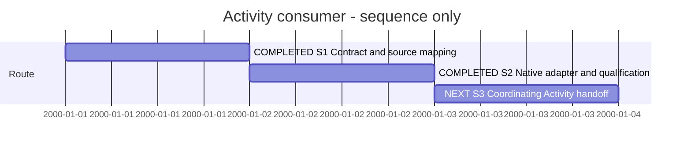

# Session — Activity producer consumption

## Session roadmap

Current turn T001; current step S3 coordinating handoff. Timeline dates are sequence
slots only, not elapsed time or forecasts.

| State | Step | Work and linked plan milestone | Prerequisites | Authorization | Completion evidence / outcome |
| --- | --- | --- | --- | --- | --- |
| completed | S1 | Resolve FUNC-032 / UR-046 / SR-029 mapping and Activity target contract | Producer design | SDP Activity0002 A3 assignment | Existing SDL ownership retained; independent expansion target selected |
| completed | S2 | Implement and qualify model-free view and atomic page expansion | S1 | Same bounded assignment | Seven targeted checks and two real producer/native workflows pass |
| next | S3 | Return consumer candidate and limitations to coordinator | S2 | Same bounded assignment | No merge, installation or publication |

Manual Session format 1.

| Field | Value |
| --- | --- |
| Session reference | SESSION-XFMD-0009 |
| Status | active |
| Primary card | Coordinating SDP KB-SDP-061 / Activity0002, PLAN-SDP-0027 A3 |
| Snapshot date | 2026-11-12 |
| Current step | S3 |
| Proposed next step | S3 |
| Execution authority | Owner-authorized SDP Activity0002; bounded collaborating XFMD assignment |

## Goal

Consume producer-owned Activities roots, generated Markdown and deferred child
pages without introducing Activity semantics into XFMD. The coordinating contract
is `/home/warloc/git/SDP/SDP/Activities/Activity-0002--Activity-Management/04-Design/ImplementationContract.md`.
Its implementation plan owns the delivery boundary; this Session records the
collaborating consumer work, not owner acceptance.

## T001 — scoped worker implementation

Manual work summary; host turn identity and exact start time are unknown.
Loaded installed SDP entrypoint/Worker and repository instructions, manifest,
requirements, architecture, FUNC-032, canonical SDL source mapping and Session guide.
The primary XFMD worktree is dirty with unrelated RPM/process work. Created isolated
`/tmp/xfmd-activity-management`, branch `sdp/activity-management`, from main `8893a32`.
No unrelated changes were staged or copied.

The producer and consumer agreed `activity-view` with profile `activity/1`, absolute
source area and caller-owned output bundle; no model is required. Deferred nodes
use separate `expansionTarget`/`activity-tree` with exact-parent, project/revision
and descendant-ID checks. View click and child expansion remain distinct.

Source changes stay within existing FUNC-032 ownership. Source design mapping
remains `SdpProjectNavigation` / `SdpProjects` / `SdpToolProtocol`; the canonical
model makes no per-wire-field proof claim. Blueprint, requirements and architecture
now describe the concrete adapter. Targeted tests and native evidence are retained in [Activity-A3-001](../05--Implementation/SDP-Navigation/evidence/Activity-A3-001/README.md).
Existing global GUI row/depth limits remain explicit constraints; paging does not
by itself qualify unlimited browsing. Coordinator notified of that limitation.

### T001 worker outcome

Product edits are frozen for coordinating review. Five protocol/navigation/native
checks pass, plus prior Dynamic/Runtime GUI checks (two passes). Actual producer
native tests pass against the CLI-created disposable project and real manual
Activity0002 read-only. The calendar SVG is inspected in actual native output.
The isolated test binary's source inputs, producer digest, screenshots and exact
commands are recorded in Activity-A3-001. Blueprint and symbol checks pass.

Native collapse now frees rendered subtree widgets, permitting all 5,000 documents
in a test catalog to be visited within the 4,096 visible-row bound. Retained paging
depth limits, old-client negotiation/fallback, existing SDP-basename root ambiguity
and final integrated qualification remain explicit. No commit, merge, installation
or publication occurred. The coordinator owns coherent product review/commit and
final acceptance. Next S3: consume this handoff and reconcile remaining A3 limits.

## Integrated qualification handoff

Consumer a558c31 and producer SDP eb11ac7 passed the selected native workflow gates;
the independent Activity2 reviewer approved technical qualification. The actual
manual Activity history was only read in native tests. Final evidence is retained
with Activity0002 in the SDP repository. Work remains on its isolated branch;
primary-worktree RPM/process changes are untouched. No merge, installation or
release is inferred from technical approval.
