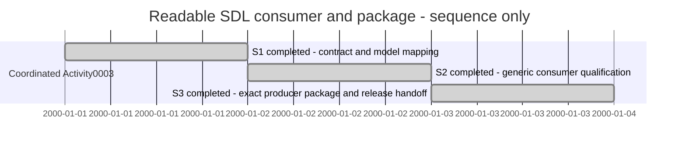

# Session — readable SDL consumer and XFMD 0.10 package

## Session roadmap

Sequence slots only; no elapsed-time or forecast claim.

| State | Step | Work | Authority | Evidence |
| --- | --- | --- | --- | --- |
| completed | S1 | Reconcile protocol, requirements, blueprint and model responsibility | ACTIVITY-SDP-0003 / PLAN-SDP-0028 B3–B5 | Activity0003 consumer handoff |
| completed | S2 | Generic producer presentation and native qualification | Same bounded assignment | 90 configured tests and real fixture/HEOS native workflows pass |
| completed | S3 | Exact producer pin, 0.10 RPM and coordinating release handoff | Owner 0.10 / feature-branch publication authorization | Reviewed signed RPM, public upgrade/fresh install and installed native workflows pass |

| Field | Value |
| --- | --- |
| Session reference | SESSION-XFMD-0010 |
| Status | completed |
| Current step | Complete |
| Coordinating work | /home/warloc/git/SDP/SDP/Activities/Activity-0003--Readable-SDL-browsing |
| Primary plan | PLAN-SDP-0028 |

## Goal and turn outcomes

Manual Session format 1. Host turn identity and exact start timing are unknown.
Deliver generic producer-owned SDL browsing and an exact matching producer in
XFMD 0.10, preserving unrelated primary-tree work and qualified Activity2 history.
The coordinator owns integrated qualification and independent review.

T001: recovered4c77944 and created isolated sdp/readable-browsing. Read SDP
entry/Worker/Planning/Release, current contract/plan and local source/model,
blueprint and release instructions. The SdpProjectNavigation / SdpProjects /
SdpToolProtocol mapping remains accurate at its documented structural level.
Selected wire and display behavior was documented before native changes.

Implemented marker/capability agreement, catalog-bound primary selects,
independent deferred model targets, presentation-preserving atomic merge and
exact labels/order without SDL repairs. Legacy display/activation is retained.
Nine targeted protocol/native/Activity checks pass, including native expansion
versus primary activation and opaque collection actions; blueprint/symbol checks
pass. Evidence currently applies to4c77944 plus the working diff, not a clean
commit. Real producer native/PDF test has been built and awaits its executable.

Prepared 0.10 packaging machinery for a committed, digest-checked producer Git
archive, matching embedded BuildRevision, source and dependency notices. Final
producer pin is deliberately absent until the coordinator freezes the candidate.
Pinned public0.9 predecessor upgrade and installed private-helper identity/default
lookup probes are selected. No RPM build, signature, DNF or publication claim.
Next: run actual producer native qualification, record exact pin and hand off
coherent consumer candidate for independent integrated review.

T001 development qualification update: all 90 configured CTests pass; six final
GUI/protocol checks pass after preserving exact terminal-row labels and moving
producer diagnostics to tooltips. Actual native fixture and HEOS Micro/Base tests
pass against a captured development producer binary. They verify exact source
selection, Back without regeneration, fixture all-source freshness, all-viewpoint
ordering, collection/detail selection and native/PDF output. Base System and Kernel
structural artifacts expose a remaining typography assessment for the coordinating
reviewer; successful export alone does not establish all print usability.
S2 is complete at its bounded development boundary. S3 awaits the coordinator's
final committed producer pin, then clean exact-candidate package qualification.

T001 exact producer update: final supplied 7370e29 source archive builds with its
actual embedded revision and retained module/Go standard-library notices. Three
native runs (fixture, HEOS Micro and HEOS Base/Kernel) pass all eleven landing
activations, advertised visual admission, collections/details, Source files/file
projections, source spans and retained Back. The current panel geometry resolves
the earlier small-font finding in inspected A4 containment/FileApi figures.
The updated target builder image is cached. Next: commit the native milestone and
packaging source, then run clean exact-candidate RPM verification; publication
still waits for coordinating final independent review.

T001 package checkpoint: candidate bdd0602/0.10.0-75 stopped at 88/89 CTests;
StandaloneMermaidGuiTest asserted before the documented 200 ms filter debounce and
async row refresh. Corrected the test's bounded readiness wait, preserving its
activation assertion; targeted native check passes. Environment explains 90 host
vs 89 container (no Window Maker/XTEST tests, plus real producer reading test).

Coordinator requested a quiescent checkpoint for Activity reference reconciliation;
no build/test/edit ran during that hold. Resumed on explicit coordinator message.
Final producer correction c3463b7 adds canonical generic Activity folder guidance.
The successor package pins that exact archive and adds installed real Activity and
reading/source/history native probe tools outside the RPM. Local preflight of the
real Activity creation/native render passes. The next clean candidate build and
public signature/DNF gates remain pending; nothing has been published.

## T001 final work summary

The bounded consumer/package delivery is complete. Exact source
8546e956d1a941ece9195d335b7196abea905289 and private producer c3463b78d53ebf984b0f553ebe93a556fb3ac6a8
produced signed public xfmd-0.10.0-76.el10_2.x86_64.rpm. All 89 target CTests and
policy checks pass. Clean local signed predecessor upgrade, preservation/removal
and fresh install pass, including installed default producer lookup, native reading
all 11 landings/render/source/Back and real Activity fixture workflows.

Coordinating independent agent review approved the exact source/archive/unsigned
package, then verified actual signed payload and public evidence with no findings.
Verified-existing publication reused the tested bytes. Forced public package and
metadata signatures, actual signed 0.9-to-0.10 DNF upgrade and fresh public install
pass repeated exact app/producer/native workflow probes. The final receipt records
unsigned/signed/producer hashes, server time and verification completion time.
[Release evidence](../Maintenance/RPM/0.10/README.md) and checklist retain all gates.

Skills/routines: SDP entry, Worker, Planning, Versioning, Release and Traceability.
Current requirements/architecture/blueprint retain the producer-owned presentation
boundary and existing structural source-model mapping. Historical checkpoints and
append-only ledger bytes remain. Final records are evidence-only; source 8546e95
continues to identify the published package. Feature branch push preserves main
and the primary dirty worktree. Owner personal review and host installation were
not claimed. This is a work summary, not an advance transcript of the final answer.
