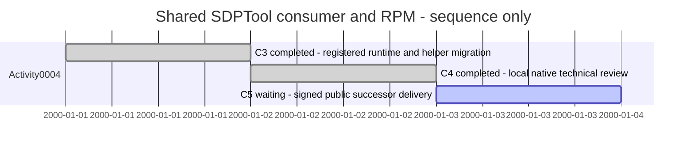

# Session — shared SDPTool consumer and XFMD0.11

## Session roadmap

Sequence only; synthetic dates express dependency order, never elapsed time.

| State | Step | Work | Authority | Evidence |
| --- | --- | --- | --- | --- |
| completed | C3 | Registered native runtime; remove package producer and preserve managed SDUI workflows | ACTIVITY-SDP-0004 / PLAN-SDP-0029 / KB-SDP-063 | This Session and RPM 0.11 work area |
| completed (local gate) | C4 | Exact shared distribution, clean target upgrade, offline installed native tests and independent review | Same owner execution assignment | Pending shared engine/helper candidate |
| waiting | C5 | Successor signed RPM after canonical/shared extension publication | Coordinator release gate | Publication pending; no main merge |

| Field | Value |
| --- | --- |
| Session reference | SESSION-XFMD-0011 |
| Status | active |
| Current step | C5 — waiting for canonical CI/shared public gates and explicit publication disposition |
| Coordinating Session | SESSION-SDP-0021 |
| Primary plan | PLAN-SDP-0029 |
| BranchPolicy | phase; sdp/shared-tool-installation |
| CommitPolicy | milestone |

## Goal and turn outcomes

Manual Session format1. Owner authorizes Activity4 execution and successor0.11
RPM after qualification of one canonical engine installed/updated through gh
extension, with explicit setup registration. Native XFMD must browse without gh,
auth or network and retain supported source/history/Activity/SDUI behavior.
Independent review and coordinating publication gate remain separate. Primary
/home/warloc/git/xfmd dirty main is excluded; isolated checkout starts140be2b.

T001: read local instructions, SDP entry/Worker/Release/document workflow,
installed manifest, Activity4 contract/plan, source organization and native
requirements/architecture/blueprint. Inventory returned immediately: SDUI preview,
readiness check and detached Fyne host depend on two private helpers. Canonical
managed helper/CLI contracts requested before removing their supported workflows.

Reconciled native public runtime contract in requirements/architecture/blueprint
and model README before implementation. Runtime selection now resolves HOME's
public entrypoint directly and preserves explicit developer override; startup and
schema failures guide setup/update. CMake removes tool install payload. Package
pipeline removes pinned producer source/build and accepts an exact external shared
distribution as qualification input. Predecessor is the signed published0.10.0-76
with its recorded hash. Installed probes use actual setup and no override, assert
no gh/private engine and run in a network namespace. Native build passes against
140be2b plus working diff; no clean RPM or review claim yet. Shared helper routes,
exact engine candidate and clean qualification remain pending.

T001 helper contract received: canonical `sdui preview/check/run` routes, same
source/entry/revision/output or interactive watch flags; preview/check are shared
engine library calls and Fyne is embedded/extracted by that same distribution.
Updated SduiTools, navigation and prototype lifetime code to use these routes;
explicit developer helper overrides retain original argv. No private lookup or
fallback remains. Six targeted native/protocol/Activity checks, blueprint and
symbol validation pass before helper integration; shared candidate qualification
will refresh the evidence. Main watcher source accepts explicit shared-engine
qualification options; no live watcher configuration was edited.

Native default-selection regression now verifies missing and incompatible public
registration with poison old sdptool/gh on PATH, then exercises the registered
fixture through the existing105-generation/history lifecycle. It passes alongside
SdpProtocolTest. First run exposed the sidebar's100-byte display bound hiding
setup guidance after a long path; moved actionable setup to the start and retained
the full selected executable in the tooltip. This is an implementation discovery
within the existing diagnostic obligation. Builder image is cached from the
updated no-Go recipe; network-namespace capability smoke check completed.

C3 capability review: coordinator/reviewer identified that wire schema alone does
not establish the selected shared runtime operations. Added version preflight
requiring runtime.setup/1 and sdui.source/1, independent of version/commit labels;
added same-schema2.2.1 missing-capability fixture rejection. The native prototype
bundled flag controls launch readiness, with explicit developer host override;
source-engine browsing remains available without an embedded Fyne host. Installed
qualification copies exact engine bytes into isolated HOME's extension directory
before actual setup, respecting stable target registration. Exact d755c84 host
build/all 90 tests passed before this review correction; current targeted evidence
will supersede its runtime compatibility claim.

Capability correction targeted results: SdpProtocolTest, SdpRuntimeGuiTest and
SdpActivityGuiTest all pass; same-schema missingcaps now gives specific setup
recovery. Blueprint/link and symbol validators plus exact-publication byte-guard
unit tests pass. Current working diff is d755c84 plus capability/setup-target
changes; clean target qualification waits for coordinating exact bundled engine.

Coordinator confirmed the canonical embedded Fyne helper's actual dynamic library
inventory. Added its OS runtime dependencies to the successor RPM and target image;
this preserves native SDUI behavior without distributing another tool or updater.
Installed exact-candidate native probes now include SDUI preview/source/check,
prototype launch/lifetime and explicit helper overrides, alongside reading and real
Activity, all under the registered default and isolated network namespace.

Exact3f61cde host build and all 90 configured baseline tests pass. Coordinator
supplied final canonical2.3.0 source 63b7f8303f3688d135272913bb437895f11080f2,
engine SHA2568c7c21fc616b57a4dc4b20eba0fa9cd03418ca31335a00b5d4da02f6d88d3c82.
The exact one-file qualification input is captured separately as gh-sdp; it is
not an XFMD package payload. Clean target qualification is next. Publication
remains prohibited pending fresh coordinating review and artifact qualification.

Final canonical engine SDUI workflow passes locally after requesting the machine
format explicitly with the supported global prefix `sdptool --json sdui preview`
and `check`; interactive run and original explicit helper argv remain unchanged.
OS-dependency image build, blueprint/link and symbol checks and publication guard
unit tests pass. The successor source is ready to freeze for exact clean RPM
build/upgrade/offline reading, Activity and SDUI qualification; publication remains
pending coordinating review and root authorization.

Full target e18f521/dab8a03 trial failed five previously optional legacy producer
checks after enabling them: stale diagram/overview URI assumptions, independent
expansion targets and preserved standalone grouping. No RPM qualified. All five
were inspected before changing expectations; no product regression was found.
[Test contract reconciliation](../Maintenance/RPM/0.11/Test-contract-reconciliation.md)
records why the Activity0003 opaque reading contract supersedes those assertions
and exactly which source/history/dirty/stale/cancellation checks remain.

Five corrected tests plus real SDUI and reading all pass against final canonical
engine 774e150774d184d0604ae78f274586eeb2bad495 (SHA256
2cfcf12f8bfb0d6fa8d11391db874f68d9bc9210c85974ff3cecee50f915ced6).
This supersedes earlier engine candidates, which remain failed/aborted trials.
The next native milestone changes only tests/documentation; final qualification
will use a fresh clean build/output and retain all configured tests. Coordinator
also explicitly authorizes pushing only the selected phase branch; no main merge
or publication before independent artifact review and shared distribution gates.

Qualified checkpoint: exact source 16e57a34d5b0dd5f9f1ba8c49d96ab2fbe60048f and
external engine 774e150 pass all 95 target CTests/policy checks, signed predecessor
upgrade/removal, actual setup, offline installed reading/SDUI/Activity and
reinstall/remove/fresh preservation. [Release handoff](../Maintenance/RPM/0.11/README.md)
records exact hashes and copied receipts/logs. The verified-existing guard passes.
The selected branch is pushed; main and the primary dirty worktree are untouched.
Independent artifact review, shared engine/extension publication and successor RPM
publication remain distinct pending gates. Evidence-only record updates preserve
source 16e57a3 and RPM 81 as the qualified candidate.

Coordinator relayed independent approval of the exact local native technical gate;
read and preserved the actual [review record and receipt](../Maintenance/RPM/0.11/evidence/qualified-81/review-receipt.json).
The reviewer checked actual95-pass evidence, RPM/source/payload/engine/probe hashes,
real offline Fyne/reading/Activity and package lifecycle. Local C4 is complete at
that bounded technical scope. Canonical exact-source CI and shared public
publication/verification remain pending; C5 waits for the coordinator's explicit
publish-existing go-ahead. No package bytes are rebuilt or requalified, and no
overall Activity completion, publication or owner acceptance is claimed.
